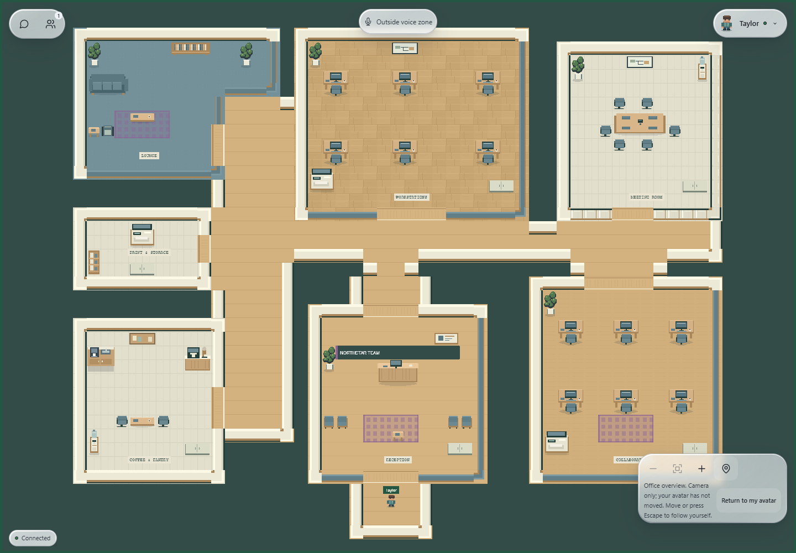
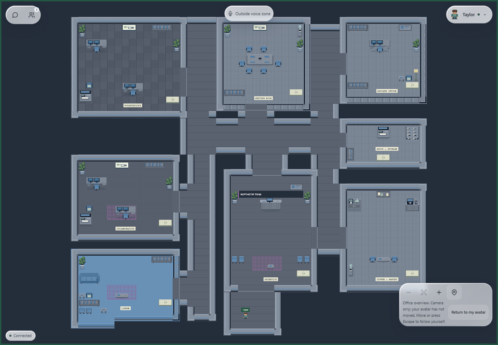
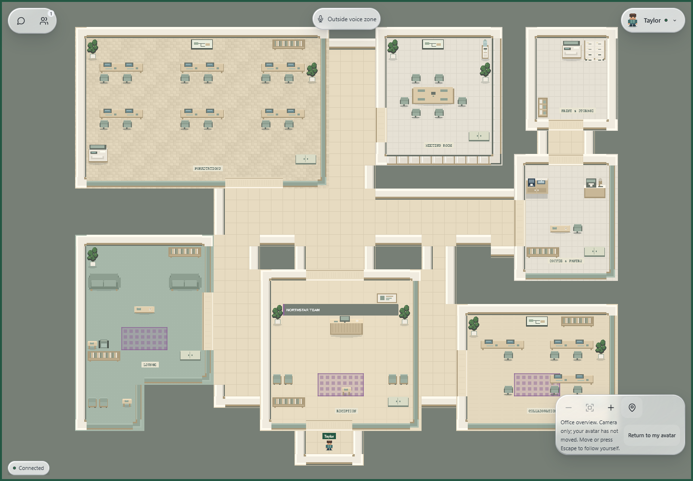
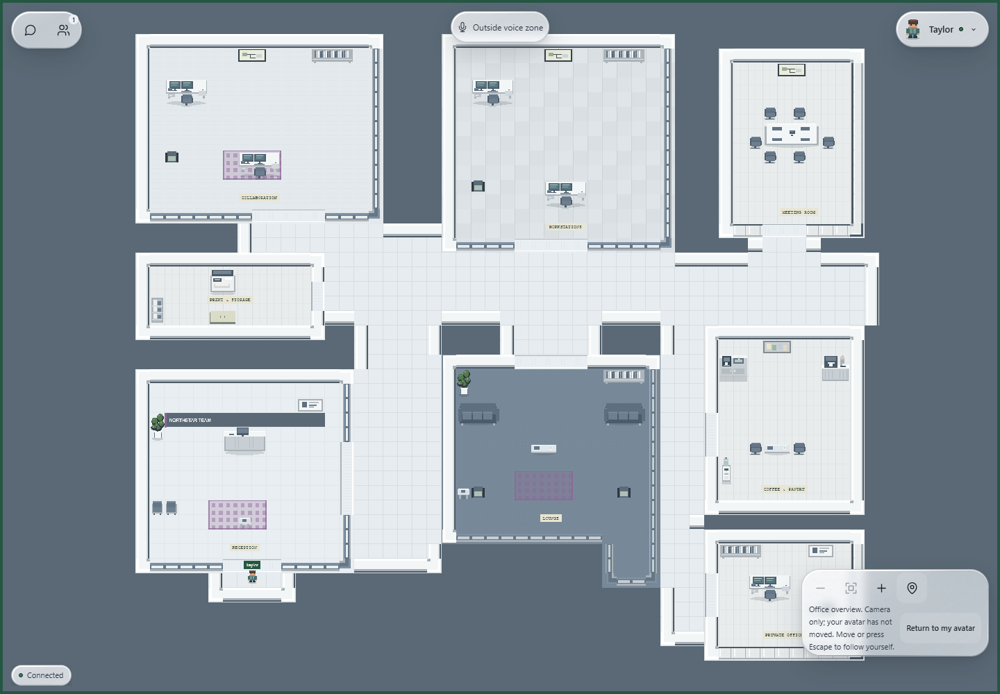
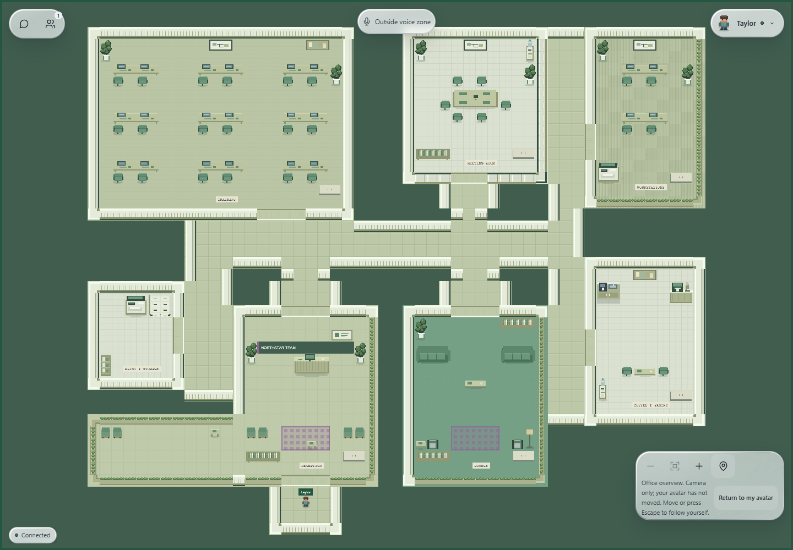

# Architectural office layout upgrade

This report records the architectural stage. The subsequent [asset expansion report](office-asset-expansion.md) describes the current asset registry, larger atlas and latest screenshots.

Implemented and validated locally on 30 October 2026. The five existing selectable layouts now compose actual architectural room boundaries and circulation, rather than furniture islands on a rectangular open floor. The Liquid Glass HUD, owner settings flow, saved configuration schema and multiplayer protocol are unchanged.

## Layout changes

| Layout | Grid | Architectural organization |
| --- | --- | --- |
| Open Office | 51 × 40 | Open workstation neighborhood, L-shaped reading lounge, glazed meeting room, offset reception entry and separate pantry/utility rooms off a bent spine |
| Corporate HQ | 53 × 47 | Formal departments, glazed meeting/private offices, circulation branches, enclosed collaboration, separate print room and a lounge with a stepped reading nook |
| Startup Office | 51 × 41 | Broad shared work floor, low collaborative screens, a meeting room reached from a side corridor, coffee/utility suite and stepped social lounge |
| Co-working Space | 54 × 47 | Shared work and collaboration neighborhoods, visitor reception, offset meeting room, social lounge wing, pantry, utility room and private office |
| Training Hub | 55 × 45 | Enclosed training suite with three rows of collaborative benches, meeting/work rooms, L-shaped reception/waiting area and amenities off circulation branches |

Exterior space is excluded from the walkable building footprint. This creates real recesses and wings without leaving unexplained walkable floor around every room. Door vestibules join offset rooms to halls. Corner pieces follow perimeter orientation; solid and low/glass treatments can meet at structural returns. All layouts retain reception, work, meeting, lounge, pantry, collaboration/training and storage programs.

## Structural and room modules

`packages/shared/src/environment/plans.ts` defines typed `RoomSpec`, `Door`, `Rect` and `FloorPlan` structures. Each room has a core rectangle, optional wings, a boundary style and explicit doors. Each floor plan defines hall footprints and a safe entry spawn. Catalog IDs remain unchanged; obsolete catalog room-order/enclosure fields were removed so the plans are the single geometry source.

`architecture.ts` supplies reusable primitives:

- Union room footprints and derive closed perimeter cells, including stepped wings.
- Solid horizontal/vertical walls, low partial walls, horizontal/vertical glazing, four rotated corner orientations and junctions.
- Explicit north/east/south/west door openings and floor thresholds.
- Jamb/vestibule padding so exterior shell walls cannot pinch a doorway.
- Protected threshold and approach cells that furniture cannot occupy.
- Theme-aware material selection with identical collision geometry: technical glazing, pale low screens and natural planted/slatted dividers.

`rooms.ts` supplies nine reusable room programs: reception, meeting, pantry, lounge, workstations, collaboration, training, private office and print/storage utility. They combine with the `RoomSpec` boundaries in the shared composer. Programs place suitable fixtures, and wing slots become reading/waiting nooks. Door clearances and architectural collision are evaluated before any furniture placement.

New original props include an espresso/service counter, water dispenser, multifunction printer, filing bank, framed wall detail, side table, paired waiting chairs and utility shelving. Existing bookshelves, whiteboards, notice boards, seating, plants and signage remain in use. Standard desks, executive return desks and collaborative benches remain selectable. Wider collaborative work rooms gain a middle desk column; the large Training Hub also gains a third seating row.

## Renderer and persistence integration

The composer still returns the same Floor, Architecture, Furniture and binary Collision layers used by Phaser and Colyseus. Existing marker, voice, rug, branding and environment metadata layers remain. Hidden Rooms, RoomWings, Doorways and Corridors metadata makes structural validation and future authoring tools possible; it adds no extra renderer or per-frame generation.

Structural arrays are cached for at most 25 layout/theme pairs and copied before furnishing. Composition remains deterministic. The static owner preview and the game consume the same composer and atlas, so the preview shows the actual partitions, doors and room shapes. No network, camera, avatar, auth, HUD or voice-service implementation was changed.

`scripts/architecture-art.mjs` extends the existing original pixel-art generator. It uses reserved regions in the 512 × 256 atlas, with an isolated drawing/cropping pass that restores existing furnishings before packing new props. A new atlas-allocation test guards against source-sprite overlaps. Five final atlases total **34,969 bytes**, with the same 128-tile contract and only one selected atlas required at runtime.

Existing saved `EnvironmentConfig` values remain valid, including owner overrides and all 10,800 combinations. No data backfill or schema migration is needed. Geometry fingerprints change with the upgraded layouts; web and realtime must run matching code. Restart/reload both local services if one is still serving the prior geometry. Future deployment still requires separate authorization and coordinated web/realtime versions.

## Screenshots

Actual local Brave renders of the editor and Phaser, using synthetic persistence and transport. These are not evidence of live authenticated multiplayer.

| Layout / theme | Capture |
| --- | --- |
| Open Office / Warm Wood / Balanced / Standard | [Full size](assets/office-architecture/open-office.png) |
| Corporate HQ / Dark Tech / Rich / Executive | [Full size](assets/office-architecture/corporate-hq.png) |
| Startup Office / Scandinavian / Rich / Collaborative | [Full size](assets/office-architecture/startup-office.png) |
| Co-working Space / Minimal Light / Minimal / Executive | [Full size](assets/office-architecture/coworking-space.png) |
| Training Hub / Eco Green / Rich / Collaborative | [Full size](assets/office-architecture/training-hub.png) |











Editor/phone captures: [desktop editor](assets/office-architecture/owner-desktop.png), [390px editor](assets/office-architecture/owner-mobile.png), [390px office overview](assets/office-architecture/office-mobile.png). The existing camera supports returning to the avatar for normal-scale navigation. Screenshots were inspected for boundaries, floor transitions, furniture/prop integrity, signage and HUD compatibility.

## Validation results

| Check | Result |
| --- | --- |
| Recursive ESLint and TypeScript | PASS |
| Web production build and realtime build | PASS |
| Web tests | 114 PASS |
| Realtime tests | 31 PASS |
| Isolated PostgreSQL environment permission/migration suite | 1 PASS |
| Brave editor/environment, office engine, chat, communication/HUD and voice suites | All 5 PASS |
| Exhaustive visible recipes and shared fingerprints | All 10,800 distinct |
| Base compositions: spawn, markers, sealed bounds, meeting voice zone and every walkable tile connected | All 225 PASS |
| Enclosures, door approaches, corridor reachability and object placement | PASS |

New tests check declared door cells against actual room perimeters, require closed collision/architecture everywhere else, reject overlapping room/prop footprints, check protected approaches, compare theme collision geometry and prove returned map mutations cannot corrupt the structural cache. All five plans include stepped room footprints and distinct circulation.

The authoritative movement simulator traverses every doorway in both directions for all 45 layout/decor/furniture geometry variants: 792 directional traversals. It also rejects standing inside any non-door room-boundary tile, including glass and low partitions.

The browser fixture adds an actual Arcade Physics probe using the production 14 × 10 avatar foot-body dimensions and the real composed collision layer. Across five rendered maps it passed **44 doorway openings in both directions** and **62 representative partition collision checks**, covering solid, glass and half-height materials in every layout. It also retains the existing editor save/revision/conflict/denial checks, live preview options, mobile width, camera/fit controls, equivalent-prop stability, one active transport and zero runtime-error assertions.

Useful commands:

```powershell
pnpm assets:office
pnpm lint
pnpm typecheck
pnpm test
pnpm --filter @virtual-office/web build
pnpm --filter @virtual-office/realtime build
pnpm test:environment:database
$env:OFFICE_TEST_BROWSER = 'C:\Program Files\BraveSoftware\Brave-Browser\Application\brave.exe'
node --test --test-concurrency=1 scripts/test-environment-browser.mjs scripts/test-office-browser.mjs scripts/test-communication-browser.mjs scripts/test-chat-browser.mjs scripts/test-voice-browser.mjs
```

During implementation, tests caught a disconnected corridor branch, narrow exterior approaches, a furniture pocket and a printer slot obstructed by a door clearance. Visual inspection also caught a sprite-atlas overlap. These were fixed and the final checks pass with the stricter assertions retained. The full five-suite Brave run passed; the environment suite then passed again with additional material-specific wall probes. No fallback/media policy was altered. One isolated fixture profile remained in ignored `.cache` because of a Windows file lock.

## Limits and extension points

- Real owner/member authenticated acceptance and real audio remain pending the dedicated signed-in Brave profiles from Phase 2. The browser save flow uses synthetic persistence, PostgreSQL permission tests are isolated, and voice UI tests use simulated SDK/media state. No live two-account success is claimed.
- The earlier development-database migration-history discrepancy is recorded in the [Phase 2 report](office-environment-phase2-validation.md). This task did not query or modify a remote database or reconcile that history.
- Boundaries are static tile modules. There are no animated/lockable doors, seat interactions, arbitrary polygon editor, uploaded assets or owner-draggable walls. Door openings are permanently walkable. Meeting voice behavior keeps its existing rectangle; private offices and the training room do not create additional voice channels.
- Add a room program in `rooms.ts`, place its core/wings/doors in `plans.ts`, and extend structural tests. New prop art must fit unused atlas cells and pass the allocation test; exceeding 128 tiles requires a deliberate renderer/map-contract update. New selectable catalog IDs still need matching persistence allowlists.
- Frame samples in existing fixtures are not a benchmark of authenticated multi-user load or physical mobile devices. The default HUD's existing reduced-effects fallback remains intact; forced glass on software WebGL is slower.

No deployment, production-service changes, remote tenant writes, Git branches, commits, pushes or merges were performed.
