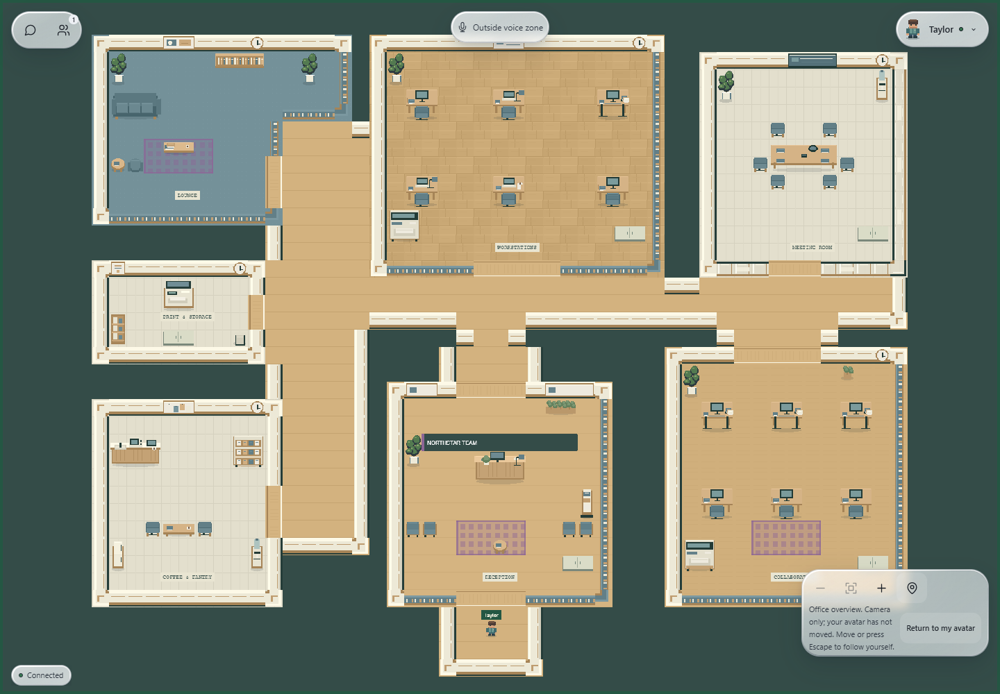
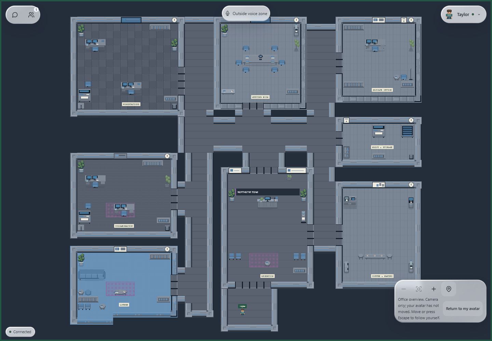
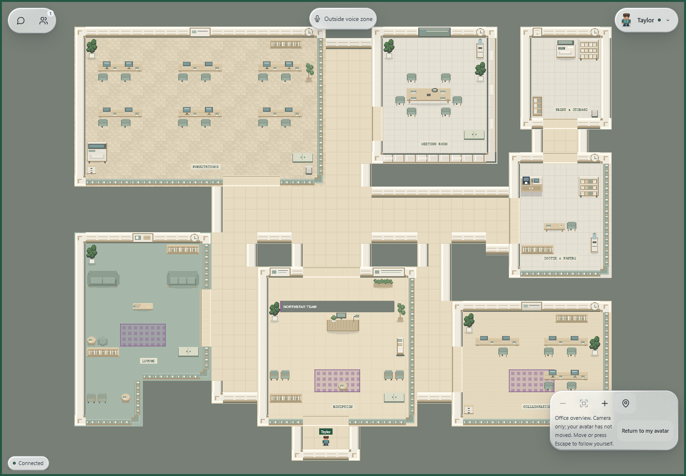
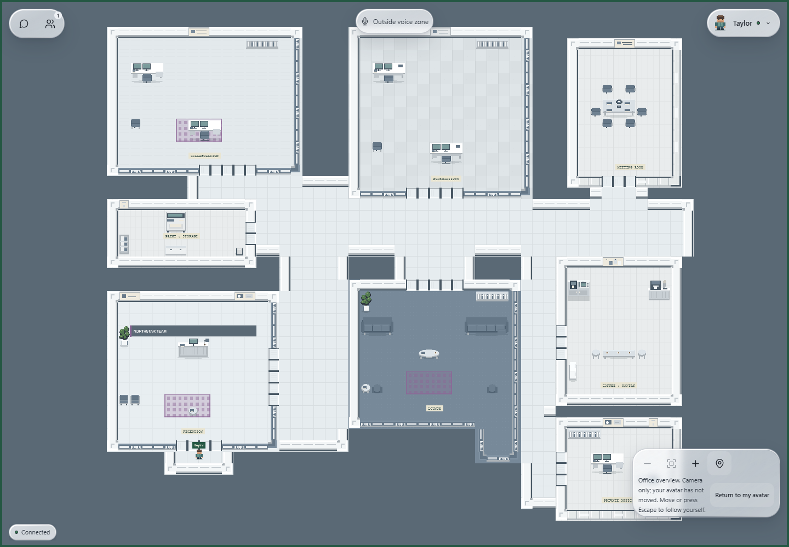
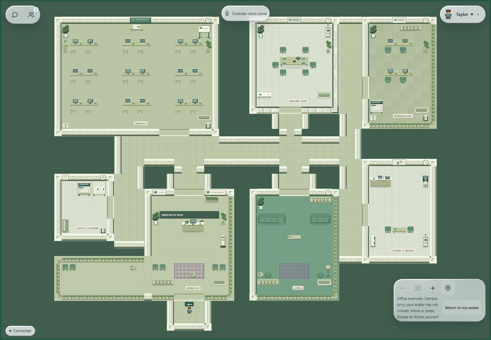

# Modular office asset expansion

This report records the asset expansion stage. The subsequent [corridor decoration report](office-passage-decoration.md) contains the latest passage rules, asset counts and screenshots.

Implemented locally on 30 October 2026 in the existing working tree. This extends the architectural environment system and preserves its floor plans, saved configuration IDs, owner controls and Liquid Glass HUD.

## New collection

Added **86 original assets** across ten categories. Alongside 26 existing fixtures, the shared registry now exposes **112 entries**. All 86 additions are actually used in at least one of the 225 base recipes; an automated coverage test rejects unused expansion assets.

| Category | Added | Content |
| --- | ---: | --- |
| Workstations | 13 | Single, dual-monitor, laptop, standing, creative, L-return and manager desks; shared/laptop benches; notebooks, desk lamps, mugs and file stacks |
| Seating | 8 | Mesh/task chairs, visitor/meeting/lounge/classroom chairs, linked waiting seats and stools |
| Storage and utility | 10 | Filing banks, drawers, bookshelves, open shelves, lockers, cupboards, printer stands, copiers, server racks and low storage |
| Reception | 5 | Formal and curved counters, brochure stand, welcome sign and branding wall feature |
| Meeting and presentation | 8 | Small/medium/large tables, whiteboard, glass board, wall display, presentation desk and conference device |
| Pantry and break | 8 | Espresso machine, water dispenser, mini fridge, microwave, snack shelf, dining/bar tables and pantry counter |
| Lounge | 6 | Compact/sectional sofas, round coffee/side tables, arc lamp and magazines; existing owner-selectable rugs remain in use |
| Decor | 9 | Framed art, certificates, clocks, pinboard, bins, tall/small plants, wide planters and desktop plant |
| Training and collaboration | 5 | Classroom desk, podium, projector table, round collaboration table and mobile board |
| Structure and partitions | 14 | Paneled wall and edge variants, frosted glazing, shelf dividers, flush doorway thresholds and corner treatments |

The artwork uses the existing 32px scale, integer-pixel primitives, restrained material palette, consistent upper-left highlights and small grounded shadows. Shape, equipment and upholstery variations distinguish the assets; no downloaded or generated stock imagery was introduced. The five themes retain their own floor materials and architectural treatments.

## Placement and variation

Room programs choose a small, repeatable recipe using layout, theme, room kind, decor level and furniture set. No random scatter is used. Desks vary by station, formal HQ reception uses the formal counter, tech utilities use server racks, natural themes favor timber/laptop/plant treatments, and training rooms use classroom furniture, podiums and presentation equipment.

Furniture and wall details have separate roles:

- **Blocking fixtures** reserve their actual tile footprint and enter the existing binary collision layer. They cannot overlap architecture, another fixture or protected doorway approaches.
- **Wall details** require architectural support and render in the new Details tile layer. They do not add collision.
- **Desktop details** require furniture support. Only one detail can occupy a detail cell, avoiding stacks of clutter and additional obstacles.
- **Structural variants** replace visual tile IDs on existing walls/thresholds while preserving the same architectural boundaries and door openings.

The first principal planter still follows the owner's planter override. Existing accent, rug and company-name controls remain effective. Reusable programs vary seating, desk equipment, meeting-table size, storage, social furniture and mounted decorations. Recipes reject incompatible slots rather than moving props into corridors. Pantry counters fall back to the compact existing counter when a wide version conflicts with a doorway; tests require essential fixtures in every pantry, reception, meeting and utility room.

Theme-aware furniture can have different footprints. Shared web/realtime composition still generates matching collision and fingerprints for the selected configuration. Connectivity, prop approaches and authoritative doorway movement are now tested across all 225 base recipes, including every theme, rather than assuming all themes have identical furniture geometry.

## Files and contracts

| File/module | Change |
| --- | --- |
| `packages/shared/src/environment/assets.ts` | Typed content registry, category/kind/mode metadata, deterministic shelf packing, structural-material lookup and atlas dimensions |
| `packages/shared/src/environment/rooms.ts` | Expanded fixture registry and theme/room-aware furniture, seating, appliance, wall and desktop recipes |
| `packages/shared/src/environment/compose.ts` | Safe support-aware placement, structural variants, Details tile layer and Decorations inspection metadata |
| `packages/shared/src/map.ts` | Explicit validation of the expanded atlas and optional Details layer; legacy maps retain their original 128-tile limit |
| `scripts/expanded-office-art.mjs` | Original drawing families for all 86 additions, with integer and per-asset bounds assertions |
| `scripts/generate-environment-assets.mjs` | Builds the expanded five themed atlases through the existing generation command |
| `environment-preview.tsx` and `office-scene.ts` | Matching Details-layer rendering in Canvas2D preview and Phaser |
| Environment/architecture asset tests and browser probe | Art uniqueness, coverage, support rules, essential fixtures, atlas contracts and actual Phaser texture/detail checks |
| `scripts/test-communication-browser.mjs` | Fixture selects explicit Glass for optical checks and checks Auto against actual resource hints |

Environment atlases are now **512 × 1024**, with **512 tiles** and a preserved first 128-tile region. New assets are packed below that region and currently fit through pixel row 832. The atlas packer fails if content exceeds its capacity. The original legacy `office-tiles.png`, `studio.json` and avatar assets remain unchanged.

Five PNGs total **101,323 bytes**. Gameplay loads only the selected themed atlas (2 MiB of uncompressed RGBA pixels), plus the existing avatar texture. No extra per-prop image requests, animation loops or dependencies were added. Geometry is composed on entry/configuration changes, not per frame; the existing finite structural cache remains in use. Details add one visible tile layer.

Owner configuration and persistence schema are unchanged. The catalog still composes 225 base choices and **10,800** accent/rug/planter configurations. No migration or backfill is needed for this asset pass. Matching web and realtime versions are required because visual and collision fingerprints change with the new recipes.

## Screenshots

Actual local Brave captures of the production React/Canvas2D/Phaser components, using synthetic identity, persistence and transport. They are visual/fixture evidence, not authenticated two-user acceptance.

| Environment | Capture |
| --- | --- |
| Open Office / Warm Wood / Balanced / Standard | [Full size](assets/office-asset-expansion/open-office.png) |
| Corporate HQ / Dark Tech / Rich / Executive | [Full size](assets/office-asset-expansion/corporate-hq.png) |
| Startup Office / Scandinavian / Rich / Collaborative | [Full size](assets/office-asset-expansion/startup-office.png) |
| Co-working Space / Minimal Light / Minimal / Executive | [Full size](assets/office-asset-expansion/coworking-space.png) |
| Training Hub / Eco Green / Rich / Collaborative | [Full size](assets/office-asset-expansion/training-hub.png) |

Additional views: [desktop owner editor](assets/office-asset-expansion/owner-desktop.png), [390px owner editor](assets/office-asset-expansion/owner-mobile.png), [390px office overview](assets/office-asset-expansion/office-mobile.png), [full Warm Wood atlas](assets/office-asset-expansion/asset-atlas.png).

## Validation

| Check | Result |
| --- | --- |
| Recursive ESLint and TypeScript | PASS |
| Web production build and realtime build | PASS |
| Web tests | 119 PASS |
| Realtime tests | 31 PASS |
| Isolated PostgreSQL environment policy/migration suite | 1 PASS |
| Brave environment/editor, engine movement/collision, chat, communication/HUD and voice suites | Each PASS |
| Expanded art in five generated PNGs | All 86 entries visible and distinct in each theme |
| Composition coverage | All 86 additions used by the 225 base recipes |
| Geometry and recipe checks | All 225 base recipes safe; all 10,800 visible recipes/fingerprints distinct |

Coverage includes atlas bounds/non-overlap, malformed atlas rejection, legacy tile limits, room-specific assets, essential room fixtures, repeatable variation, wall/surface support, every walkable tile connected to spawn, valid markers, meeting voice rectangle, protected door approaches and reachable prop perimeters. The authoritative movement simulator passes 3,960 directional doorway traversals across all base recipes.

The actual Phaser browser probe confirms 512 × 1024 native textures, exact Details tile counts (19–38 in the five gallery recipes), all 44 doorways in both directions and 62 representative solid/glass/half-height partition checks. Existing preview controls, saved fixture revision, conflict/denial feedback, mobile width, camera/fit behavior, one active renderer/transport and zero runtime-error assertions pass.

An initial communication fixture run timed out because it expected Auto to select glass even when Brave reported 4 GB memory. The fixture now explicitly selects Liquid Glass through Settings for optical checks and retains Auto/resource/accessibility fallback assertions. Its rerun passed with the same low-memory hint. No product HUD or fallback implementation was changed. The first combined browser log therefore contains that superseded fixture failure; the other four suites passed, and communication passed separately after the correction.

Reproduce with the existing `pnpm assets:office`, `pnpm lint`, `pnpm typecheck`, `pnpm test`, web/realtime build scripts and environment database/browser scripts. For Brave, set `OFFICE_TEST_BROWSER` to the installed Brave executable before running browser suites. Generated asset files must accompany matching web/realtime code.

## Limits and extension points

- These fixtures do not replace real authenticated owner/member acceptance or real audio testing. Those remain pending the dedicated signed-in Brave profiles described in the earlier validation reports. No remote account, organization or settings record was changed.
- Assets are static and code-owned. There is no drag-and-drop furniture editor, uploaded artwork, animated appliance, interactive seat or lockable door. Existing room/voice behavior is retained.
- Frame samples from the software-WebGL HUD fixture are not a production multiplayer benchmark. Forced Glass remains slower than the existing automatic Solid fallback on software rendering; that policy is unchanged.
- Add content by defining dimensions/category/support mode in `assets.ts`, drawing its family/variant in `expanded-office-art.mjs`, and using it in an appropriate `rooms.ts` recipe. The coverage and bounds tests require actual usage and valid art. Keep new blocking placements inside circulation-safe slots and extend representative browser captures.
- The 512-tile contract has spare rows, but future overflow requires an explicit atlas/validator/renderer update. New owner-selectable catalog IDs would also require the existing database allowlists to be extended; this pass introduces no new saved IDs.

No branch was created or switched, and no commit, push, merge, deployment or remote database mutation was performed.
