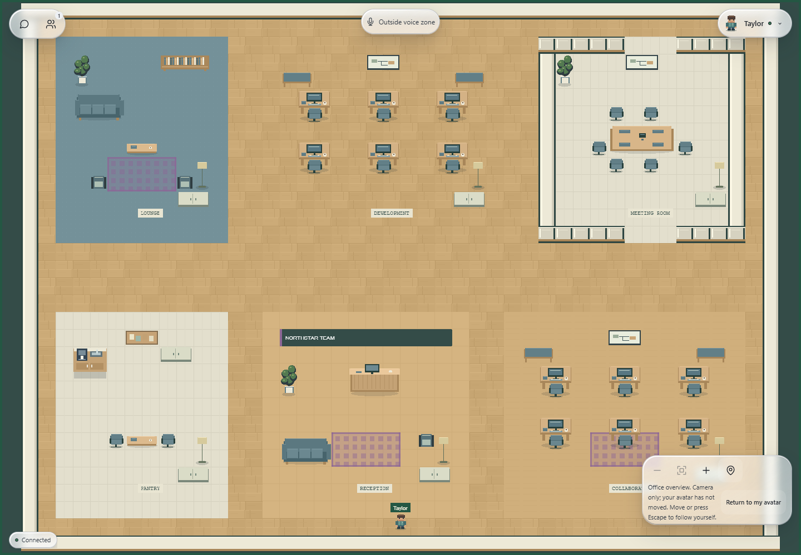
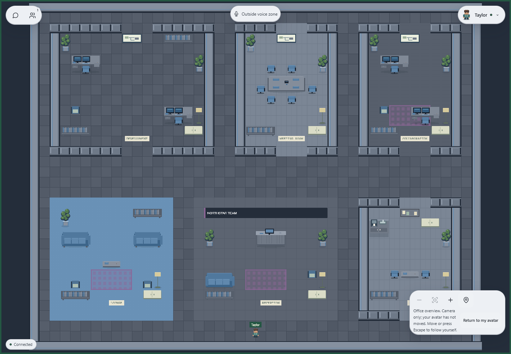
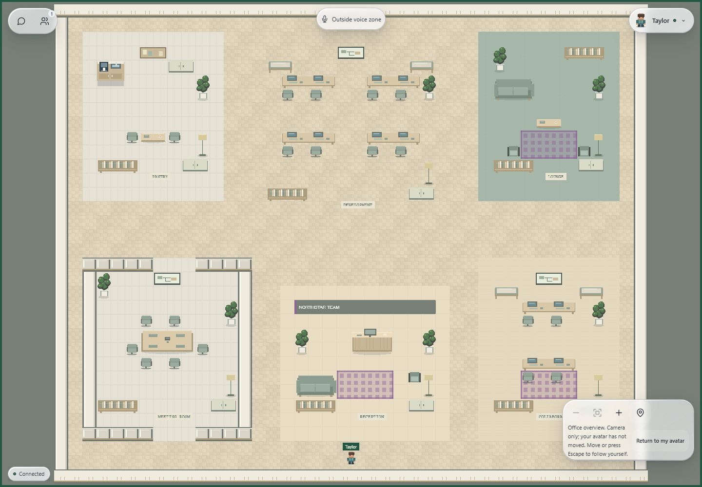
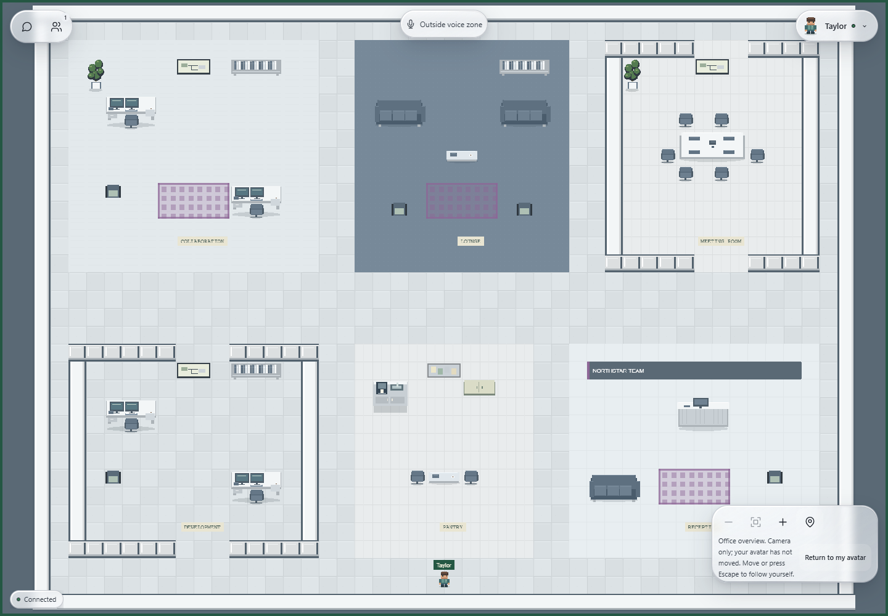
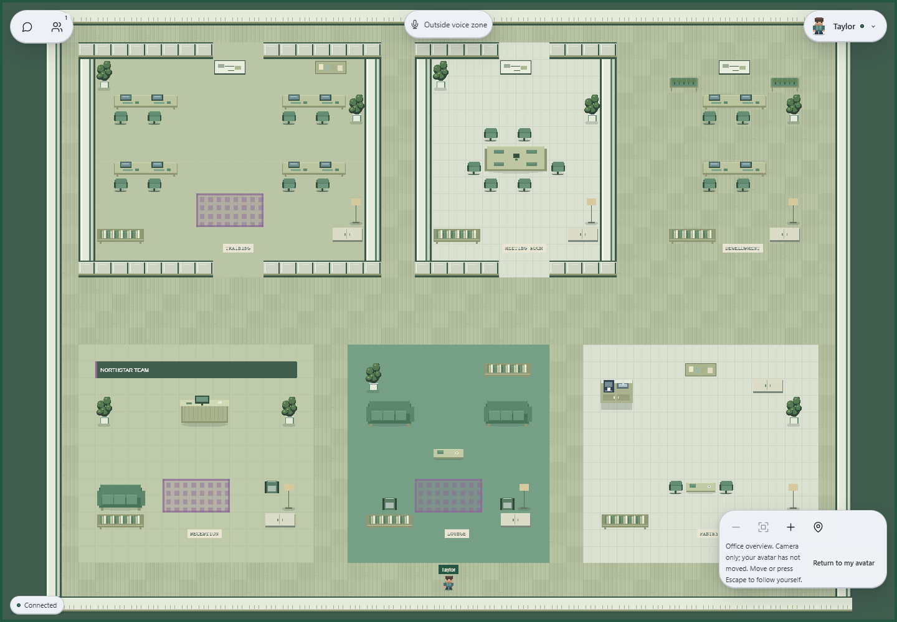

# Office environments: Phase 2 local validation

Completed local visual polish and automated validation on 29–30 October 2026. **Authenticated owner/member acceptance remains pending.** The user confirmed the two separate signed-in Brave profiles are not ready. No dedicated test organization was selected, and no remote tenant settings were saved.

## Visual and implementation changes

- Added `packages/shared/src/environment/plans.ts`: five floor plans with deliberate room sizes, enclosure rules and circulation. Open Office is 44 × 32, Corporate HQ 44 × 34, Startup Office 42 × 34, Co-working Space 46 × 34 and Training Hub 48 × 36 tiles.
- Improved reception counters and waiting areas, six-seat meeting tables, lounges, coffee corners, workstations, partitions, storage and plants. Standard desks, executive return desks and shared collaborative benches use distinct artwork and footprints.
- Extended the existing procedural pixel-art pipeline through `scripts/polish-environment-art.mjs`. Themes now have different material patterns: staggered oak, large stone joints, Scandinavian herringbone, raised technical panels and bamboo strips. Furniture includes monitor stands, cushions, slats, books and small desk details; all drawing remains on integer pixels.
- Fixed chair/storage arrangements that created isolated floor pockets and moved reception plants away from company signage. Bounds and collision checks still reject overlapping placements.
- Removed the preview's fixed aspect ratio so each layout retains its actual proportions. The Liquid Glass HUD implementation, movement, camera, voice services, authorization and multiplayer protocol were not changed.
- Added hidden placement metadata for geometry validation and strengthened existing tests. No dependency was added. The five generated 512 × 256 atlases total 25,465 bytes; only the chosen atlas loads in-game.

The catalog remains five layouts, five themes, three decor packs and three furniture sets. These yield 225 base combinations. Eight accent choices × three rug choices × two planter choices produce **10,800** compositions, without storing thousands of maps. Company signage is additional. Existing `EnvironmentConfig`, per-office JSON settings, revision checks and the owner RPC remain the persistence model.

## Screenshot gallery

These are actual local Phaser/React renders in Brave using synthetic fixture identity, transport and persistence. They demonstrate appearance and UI behavior; they do not demonstrate authenticated multiplayer. The gallery uses the unchanged HUD; an isolated test profile explicitly selects Liquid Glass for representative compatibility captures.

| Layout | Theme / decor / furniture | Screenshot |
| --- | --- | --- |
| Open Office | Warm Wood / Balanced / Standard | [Full size](assets/office-environment-phase2/open-office.png) |
| Corporate HQ | Dark Tech / Rich / Executive | [Full size](assets/office-environment-phase2/corporate-hq.png) |
| Startup Office | Scandinavian / Rich / Collaborative | [Full size](assets/office-environment-phase2/startup-office.png) |
| Co-working Space | Minimal Light / Minimal / Executive | [Full size](assets/office-environment-phase2/coworking-space.png) |
| Training Hub | Eco Green / Rich / Collaborative | [Full size](assets/office-environment-phase2/training-hub.png) |

Responsive captures: [owner editor desktop](assets/office-environment-phase2/owner-desktop.png), [owner editor at 390px](assets/office-environment-phase2/owner-mobile.png), [office at 390px](assets/office-environment-phase2/office-mobile.png).

Screenshots were inspected for furniture placement, boundaries, floor transitions, material consistency and HUD overlap. Small room labels remain pixel-art signage; this phase does not introduce interactive furniture or editable wall geometry.

## Owner customization results

| Check | Result and evidence scope |
| --- | --- |
| Five layouts and five themes | PASS: actual editor preview and Phaser gallery; different plan dimensions and pixels |
| Three decor and three furniture choices | PASS: preview outputs differ; exhaustive geometry coverage |
| Accent, rugs, planters and company sign | PASS: preview controls and visible recipe validation |
| Live preview and responsive proportions | PASS: displayed/intrinsic canvas aspect ratios match all five plans; 390px controls fit |
| Save, retained values and revision | PASS in synthetic persistence fixture; conflicts/denials retain controlled selections and show feedback |
| Owner enforcement and member denial | PASS in isolated PostgreSQL and service tests; anonymous owner-route denial also passes |
| Saved settings against configured Supabase with real accounts | **NOT TESTED**: signed-in dedicated owner/member profiles unavailable |

The preview uses the same composition and assets as Phaser. Equivalent configuration objects retain the current engine; browser assertions found one active transport and no runtime errors. No real account was created, impersonated or used to save settings.

## Local setup and database verification

Existing development web and realtime processes were reused at `http://localhost:3000` and `http://localhost:2567`; login and health checks returned 200. An attempted `pnpm dev:all` encountered the occupied ports and the duplicate launch was stopped. No environment file was edited. Web and realtime point to the same configured remote development Supabase; application and fixture work stayed local.

Read-only linked-database metadata checks returned true for all nine assertions in [office_environment_postflight.sql](../supabase/tests/office_environment_postflight.sql): table and RPC presence, RLS enabled, member read policy, SECURITY DEFINER RPC, owner-check text, authenticated RPC grant, anonymous RPC denial and denied direct writes. This confirms those schema/access properties, not a complete comparison of deployed SQL or real-account authorization behavior. No tenant records were queried or changed and no migration/reset/history repair was run.

**Migration history discrepancy:** `supabase migration list --linked` shows local migration `20261029000100` without a corresponding remote history entry, despite the schema objects being present. Reconcile the actual installed SQL and migration history before release; do not blindly reapply it. The CLI's incidental local version-cache modification was restored.

## Collision, voice zones and multiplayer

All 225 base compositions have sealed bounds, a valid spawn, every walkable tile connected to spawn and a reachable approach to each placed object. Meeting-room markers fall inside their voice rectangle; spawn is outside. The existing real Phaser movement/collision suite passes, including furniture contact, camera controls, resize and renderer teardown. Structural checks cover the modular geometry; they do not replace walking every corridor with real users.

Realtime tests exercise actual local HTTP/WebSocket connections with synthetic authorization, including tenant-specific composition, authoritative collision, environment-change room closure/rejoin setup and dependency outages. Voice browser tests use the actual UI and LiveKit SDK with simulated connections/participants/microphone tracks. They verify explicit join, zone cleanup, denial feedback and connection ownership; no real audio path was verified.

| Required real two-user acceptance | Status |
| --- | --- |
| Owner and member join the same customized office and see matching setup | NOT TESTED |
| Both users move and observe matching collision boundaries | NOT TESTED |
| Owner saves a different setup and both receive expected reload behavior | NOT TESTED |
| Both rejoin the updated office | NOT TESTED |
| Live meeting-zone behavior, chat and presence continue correctly | NOT TESTED |

These checks require two separate authenticated Brave profiles for a dedicated test organization. The user confirmed they are not ready. No fixture test is being counted as this acceptance test.

## Automated validation

| Check | Result |
| --- | --- |
| Recursive ESLint and TypeScript | PASS |
| Next.js production build | PASS |
| Realtime TypeScript build | PASS |
| Web unit/service tests | 110 PASS |
| Realtime unit/integration tests | 30 PASS |
| Environment PostgreSQL migration/permission suite | 1 PASS in isolated PGlite PostgreSQL |
| Production auth/readiness/voice route suite | 13 PASS against the local production-build harness |
| Exhaustive composition checks | All 225 base geometries and 10,800 distinct visible recipes/fingerprints PASS |
| Brave environment/editor suite | PASS; five actual Phaser maps, eight screenshots, zero runtime errors |
| Brave office movement/collision/camera suite | PASS |
| Brave chat suite | PASS |
| Brave communication/HUD suite | PASS |
| Brave voice UI suite | PASS with simulated media/connection |

Relevant commands: `pnpm lint`, `pnpm typecheck`, `pnpm test`, `pnpm --filter @virtual-office/web build`, `pnpm --filter @virtual-office/realtime build`, `pnpm test:environment:database`, `pnpm test:environment:browser`, `pnpm test:office:browser`, `pnpm test:chat:browser`, `pnpm test:communication:browser`, `pnpm test:voice:browser`. Browser runs selected the installed Brave executable using `OFFICE_TEST_BROWSER`; its DevTools protocol reports a Chromium/Chrome version string.

Initial browser attempts exposed Windows DevTools port-file readiness races and fixed-duration movement/media waits. Harnesses now wait for a readable numeric port, observed furniture contact/idle state and delivered reduced-motion settings while retaining the original assertions. One initial communication enhancement wait timed out and passed on rerun with actual resource/media hints logged; no production fallback policy was changed. All five suites subsequently passed individually; the earlier combined regression log includes the superseded engine timing failure.

Short fixture frame samples are not a production performance benchmark. Native GPU and software WebGL results differ considerably. Real authenticated multi-user load, audio quality and physical mobile devices remain unmeasured.

## Remaining issues and release checklist

Local visual polish and automated checks are complete. **Production readiness is not accepted yet.**

- [x] Five distinct layouts and material themes captured and inspected.
- [x] All decor/furniture options and 10,800 composed recipes validated.
- [x] Collision connectivity, spawn and meeting-zone structural checks pass.
- [x] Editor responsiveness, preview proportions and unchanged HUD compatibility checked.
- [x] Web/realtime builds, static checks, database fixture and browser suites pass.
- [x] Configured development database metadata verified without mutation.
- [ ] Reconcile installed migration SQL and missing remote history entry.
- [ ] Complete the real two-account Brave owner/member workflow above using a dedicated test organization.
- [ ] Verify live voice authorization, microphone/speaker audio and presence/chat after an environment change.
- [ ] Perform physical mobile, manual keyboard/screen-reader and representative multi-user load acceptance.
- [ ] After acceptance and separate deployment authorization, release matching web and realtime versions together.

Extension points remain content registries, floor-plan/placement modules and generated atlases. This system has no drag-and-drop geometry editor, uploaded assets, interactive furniture or visual-only hot swap; applying settings still replaces the room safely. Future catalog IDs require matching SQL allowlists and validation updates.

No Vercel/Railway deployment, production-service changes, Git branches, commits, pushes or merges were performed.
