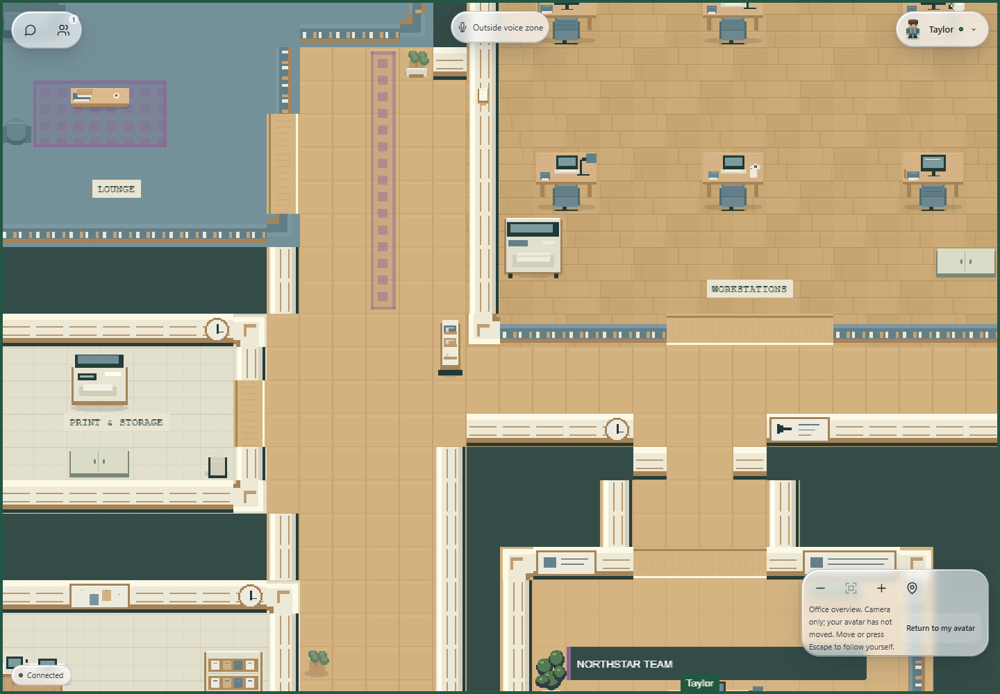
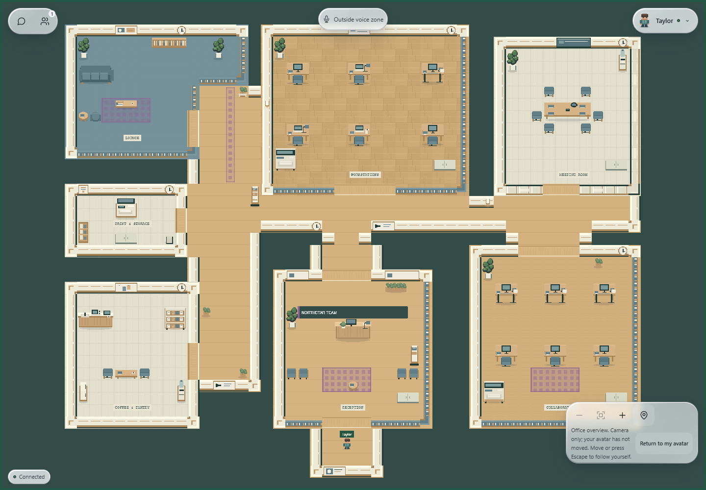
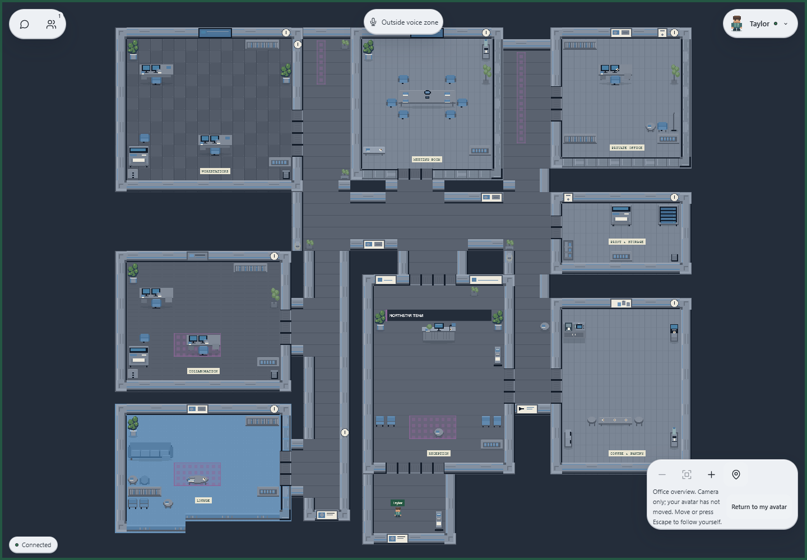
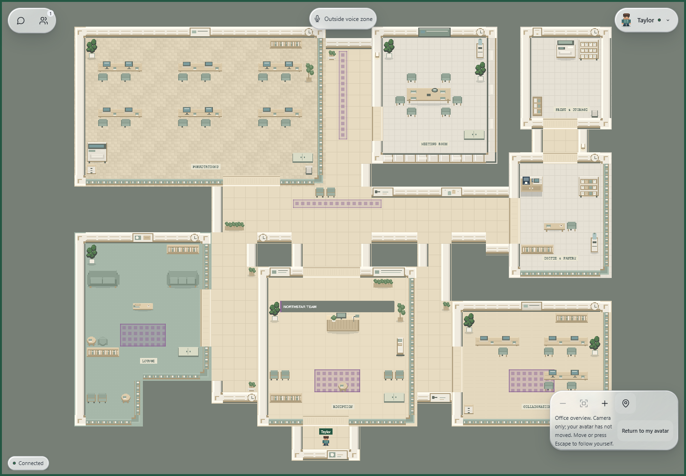
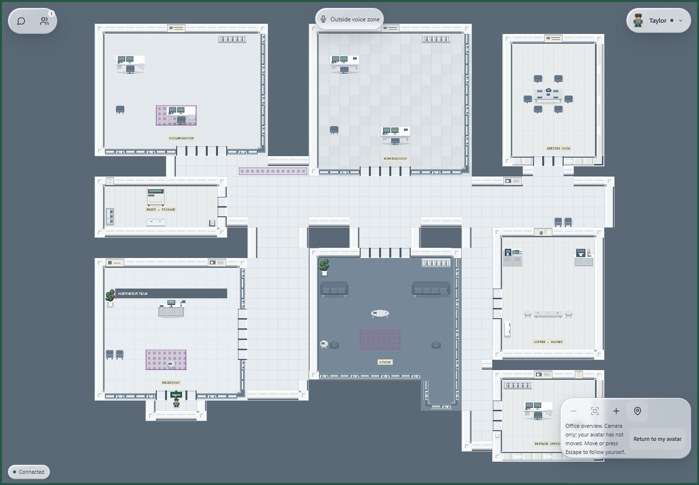
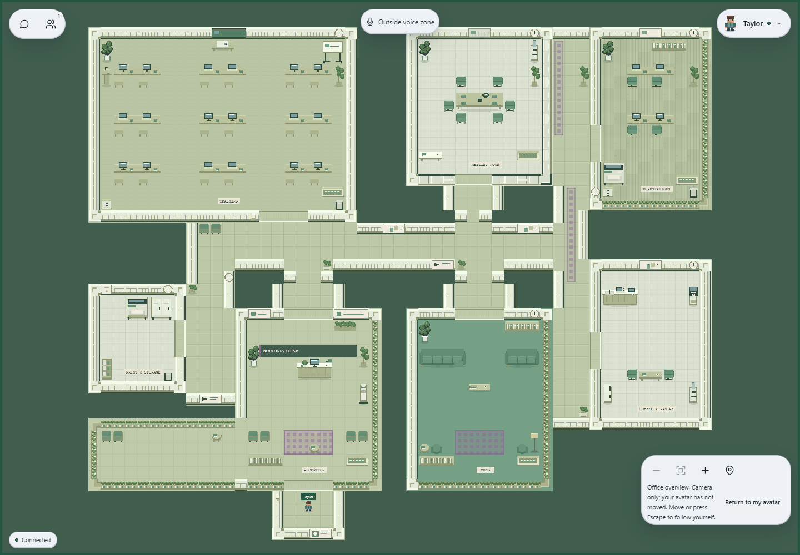

# Corridor and passage decoration

Implemented locally on 30 October 2026 in the current working tree. The existing five architectural layouts now include restrained, deterministic decoration in their connecting circulation spaces. The HUD, owner configuration schema, room programs, camera implementation and join protocol are preserved.

## Assets and visual treatment

Added six original integer-pixel assets to the existing registry and generation pipeline:

| Asset | Purpose |
| --- | --- |
| Directional sign | Small wall-mounted wayfinding pictogram at thresholds and connector spaces |
| Company poster | Framed graphic for entrance and informal corridor walls |
| Wall sconce | Compact wall light with a painted glow; no dynamic light or floor collision |
| Console table | Narrow edge table with books and a small plant |
| Magazine stand | Compact circulation amenity for a wider connector |
| Corner planter | Small planter for a safe corner or edge slot |

The pass also reuses small/tall plants, planter boxes, framed art, pinboards, clocks, waiting benches, side tables, brochure stands and floor lamps. Existing shelf-divider wall treatments remain in place. Props are chosen for the space rather than forcing every asset into every map. Narrow formal corridors therefore receive more mounted art and small accents; larger shared/training connectors can receive waiting seating or a console.

The registry now contains **118 entries**, including 92 additions across the architectural/asset/corridor stages. The five atlases still use the existing 512 × 1024 / 512-tile contract and total **105,707 bytes**. Only the selected theme atlas loads in-game. No dependency or additional rendered tile layer was introduced by this pass.

## Placement rules

`packages/shared/src/environment/passages.ts` analyzes the architectural shell before room furniture is placed. Room cores and wings are excluded from the passage footprint. It then defines:

- **Straight-wall slots:** compact plants, small lamps/tables and spaced mounted details along actual architectural edges.
- **Corner slots:** small planters; large furniture is not forced into a tight turn.
- **Junction slots:** benches, consoles, magazine stands and planter boxes where the available footprint permits.
- **Entrance-adjacent slots:** posters, lamps and compact accents outside the protected spawn area.
- **Threshold slots:** small wall signs/details flanking room approaches, with the door opening kept clear.

Each authored hall reserves two central tiles wherever the existing cross section permits. Existing cross sections of two tiles or less are fully protected against freestanding props. Door approach buffers are expanded, and a five-tile-square spawn buffer is protected. These protected cells are published as compact hidden `PassageLanes` metadata for validation.

Blocking corridor props must fit wholly inside the passage footprint, avoid protected lanes/approaches, touch an architectural edge and use at most two tiles. A candidate is rejected if it would disconnect any remaining tile of its original passage component. This prevents isolated pockets as well as broken room-to-room routes. IT cabinets, copiers and bulk storage are excluded from corridor recipes.

Decor levels set small budgets rather than filling every available slot:

| Decor | Freestanding props, maximum | Mounted details, maximum | Runners, maximum |
| --- | ---: | ---: | ---: |
| Minimal | 1 | 3 | 1 |
| Balanced | 4 | 6 | 1 |
| Rich | 6 | 9 | 2 |

Floor accents are spaced apart, repeated wall details are capped, and role/theme selection varies the recipe. Actual counts can be lower where no safe slot exists or a room detail already owns the shared wall. Corridor-mounted details require solid support; they do not cover glazing or door openings. Existing room-mounted details retain precedence.

Corporate profiles favor framed art and restrained planters; startup profiles use posters and pinboards; co-working connectors can use social furniture. Training junctions prioritize a waiting bench when a safe slot fits. Natural themes favor plants and timber accents. Choices are repeatable for the same configuration; no random scatter is used.

## Rendering, runners and performance

The composer stamps blocking passage props into Furniture and Collision, and mounted details into the existing nonblocking Details layer. `PassageDecor` metadata records the placement role without adding user-facing room labels. Canvas2D preview and Phaser consume the same composed layers.

Accent runners are short, inset rectangles on clear straight lane segments. They use the existing shared rug paint path with lower-opacity passage material, remain nonblocking, and respect the owner's accent/rug choice. **Bare floor removes passage runners.** No runner crosses into a room footprint or blocks a doorway.

Structural passage analysis is cached with the existing shell. Decoration recipes are cached privately by shell/layout/theme/decor/planter, so candidate connectivity checks do not run per frame or for repeated equivalent configurations. Returned map layers and metadata cannot mutate the cached recipe. The exhaustive 10,800-recipe/fingerprint check still passes; no map files are created per combination.

Files added/extended:

- `packages/shared/src/environment/passages.ts`: geometry analysis, protected lanes, bounded recipes, connectivity guard, runners and lane metadata.
- `compose.ts`: applies passage recipes after room furnishings, preserves room detail ownership and emits passage audit metadata.
- `assets.ts` and `scripts/expanded-office-art.mjs`: six asset definitions and original artwork; five generated PNGs refreshed.
- `visuals.ts`: restrained passage-runner opacity using the existing preview/game paint contract.
- `passages.test.ts`, existing asset/architecture tests and realtime simulator tests: passage safety and integration coverage.
- Browser probe/harness: real foot-body passage traversal, prop collision checks and a camera close-up capture; standalone module allowlist extended for the new shared module.

Saved layout/theme/decor/furniture/override IDs and Supabase persistence remain unchanged. No migration or backfill is required. Matching web and realtime code is still required because composed geometry fingerprints change with new blocking props and metadata.

## Screenshots

Actual local Brave renders of the production editor and Phaser components. Fixture identity, persistence and transport are synthetic; these captures do not claim live authenticated multiplayer acceptance.

| Environment | Capture |
| --- | --- |
| Open Office / Warm Wood / Balanced / Standard | [Full size](assets/office-passages/open-office.png) |
| Corporate HQ / Dark Tech / Rich / Executive | [Full size](assets/office-passages/corporate-hq.png) |
| Startup Office / Scandinavian / Rich / Collaborative | [Full size](assets/office-passages/startup-office.png) |
| Co-working Space / Minimal Light / Minimal / Executive | [Full size](assets/office-passages/coworking-space.png) |
| Training Hub / Eco Green / Rich / Collaborative | [Full size](assets/office-passages/training-hub.png) |

Responsive views: [desktop owner editor](assets/office-passages/owner-desktop.png), [390px owner editor](assets/office-passages/owner-mobile.png), [390px office overview](assets/office-passages/office-mobile.png). The close-up uses the fixture camera only; normal camera controls and avatar position are preserved.

## Validation results

| Check | Result |
| --- | --- |
| Recursive ESLint and TypeScript | PASS |
| Web production build and realtime build | PASS |
| Web tests | 122 PASS |
| Realtime tests | 32 PASS |
| Isolated PostgreSQL environment permission/migration suite | 1 PASS |
| Brave editor/environment, office engine, communication/HUD, chat and voice suites | All 5 PASS |
| All 225 base recipes | Connected walkability, valid spawn/room markers/meeting zone, safe props and protected approaches PASS |
| All 10,800 compositions | Distinct visible recipes and consistency fingerprints PASS |

New tests validate clear central lanes, every remaining passage component, exclusion of room footprints, compact edge-supported props, decor budgets, variation across themes/layouts, all five placement roles, usage of all six new assets, supported wall details, runner removal under Bare floor and cache mutation isolation.

Authoritative movement tests traverse clear passage lanes and stop against corridor props across all 225 base recipes. Existing authoritative doorway tests still pass 3,960 directional traversals. The actual Phaser browser probe walks **30 corridor route runs** across five configured environments, verifies passage-prop collision, traverses all 44 door openings in both directions, and checks 62 representative solid/glass/low partitions. Expanded atlas/detail tile checks, preview controls, fixture saves/revisions/conflicts/denials, responsive layout, camera controls, one active transport and zero runtime-error assertions all pass.

The only initial test adjustment was allowing brochure stands in their newly authorized passage role as well as reception. All stricter geometry/placement assertions remain. No unresolved failures remain in the checks above.

Useful commands remain `pnpm assets:office`, `pnpm lint`, `pnpm typecheck`, `pnpm test`, web/realtime build scripts, `pnpm test:environment:database` and the existing five browser suite commands. Set `OFFICE_TEST_BROWSER` to the installed Brave executable for Brave fixture runs.

## Limits and extension points

- The current budgets and clearance rules deliberately leave some narrow branches sparse. Wider hallway niches could support additional service points without reducing the protected lane.
- Signs are static pictograms. Localized room-name directories, organization-specific poster artwork and interactive guidance are future extensions.
- New slot roles or content pools can extend `passages.ts`; retain the component-connectivity, lane, door and authoritative/Phaser collision checks when adding blocking assets.
- Real authenticated owner/member acceptance, real audio and physical mobile-device testing remain pending from earlier phases. The current browser/persistence/media checks use the documented fixtures. No live-account workflow is claimed.
- Fixture frame samples are not a production load benchmark. The existing HUD software-renderer/resource/accessibility fallback behavior remains intact.

No branch was created or switched. No commit, push, merge, deployment or remote database mutation was performed.
