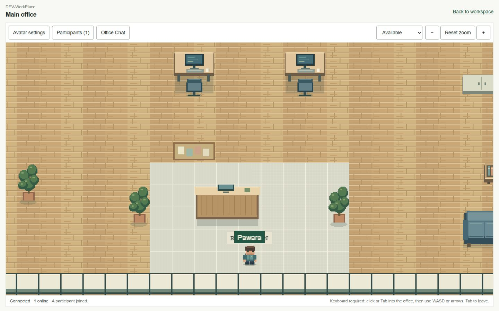
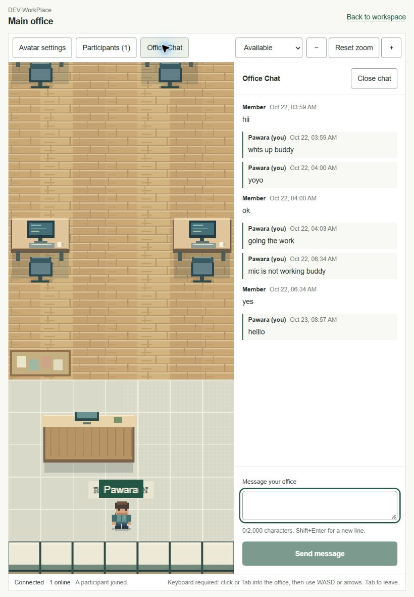
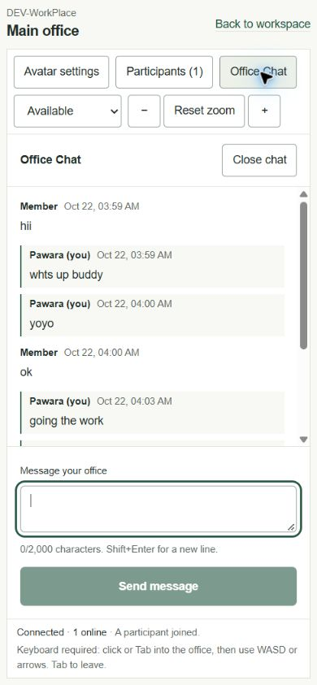
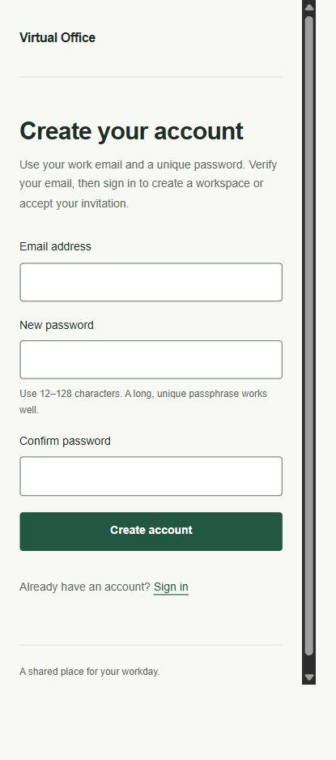
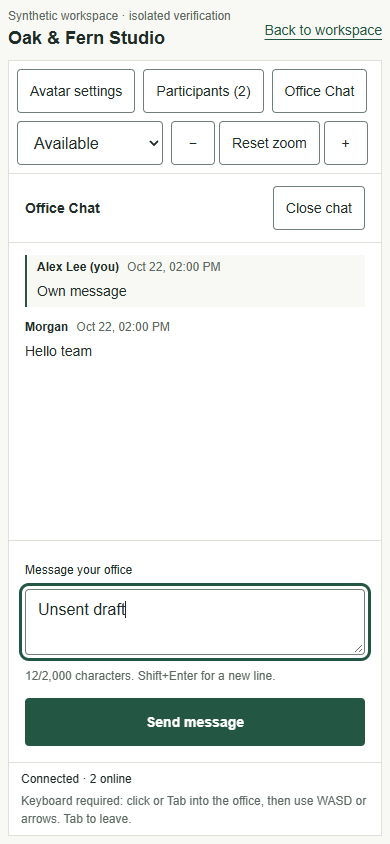
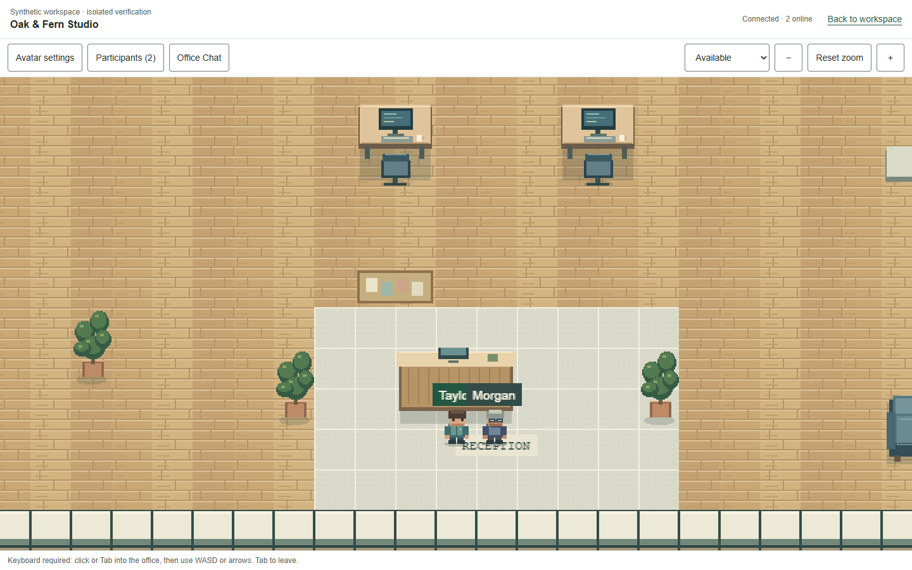
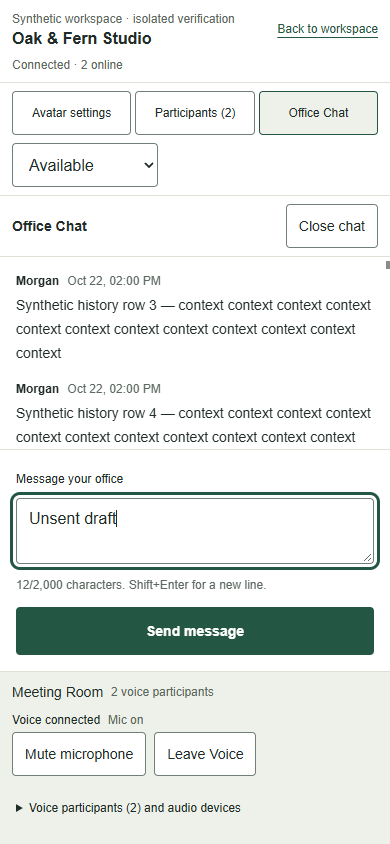

# Virtual Office V2 — UX audit and design specification

**Phase 6 · Step 0 · 27 October 2026 · Asia/Colombo**  
**Status:** Step 0 audit baseline, with completed bounded Step 1A and Step 1B implementation records in sections 15–16. Broader V2 features remain proposals.  
**Repository:** audit began on `feature/p6-s00-ux-audit-design-spec`; current verified branch is `feature/p6-s01b-office-layout-panels`. Branch identity was read from `.git/HEAD`; no Git operations were performed by the agent.  
**Product:** private virtual offices for software teams of 6–10 people, with multiple isolated companies.

**Implementation update, 27 October 2026:** the subsequent Step 1A brief approved D01–D05 as the planning baseline for a bounded foundation pass. Sections 1–14 retain the original Step 0 observations and decisions at audit completion. Section 15 records the implementation and its actual validation; the broader V2 proposals remain future work.

**Step 1B update:** section 16 records the office composition implementation on `feature/p6-s01b-office-layout-panels`. Earlier sections remain historical evidence; Step 2 features are still proposals.

## 1. Executive Summary

Keep the working Next.js, Phaser, Colyseus, Supabase, LiveKit and Resend architecture. Keep the original office artwork. The strongest V2 opportunity is a shorter, clearer everyday workflow: enter the office, find a teammate, understand their availability, and communicate without fighting the surrounding interface.

The existing product already has a coherent forest/cream palette, crisp original pixel art, explicit microphone consent, useful connection states, bounded persistent office chat and accessible native form/disclosure primitives. It does not need a generic dashboard makeover or replacement game engine.

Highest-priority findings:

| Finding | Evidence | V2 response |
| --- | --- | --- |
| Entry prioritizes a future product vision and creating workspaces over returning to an existing office | V01–V05; S01/S03 | Separate public introduction from daily entry; make the existing office the primary returning-user action |
| Workspace creation still says office access and invitations will arrive later | V07; S03 | Correct inaccurate copy in the first foundation pass |
| Keyboard movement is the only implemented movement method; phone users cannot navigate to a voice zone with the on-screen controls | V15; S05/S06 | Communication-first mobile layout initially; accessible destination navigation and pointer movement in Step 2 |
| Tablet chat reserves 340 px, leaving a 446 px canvas at the tested 820 px viewport | V13 plus current DOM measurement | Use an overlay/single-panel tablet mode rather than assuming a permanent desktop split |
| Mobile chat hides the canvas but keeps its zoom controls visible | V14/S04 | Show controls for the active surface; recover vertical space |
| The initial office view gives little orientation; zoom-out remains enabled at its computed minimum | V08/V09; S06 | Add a true fit/overview state, meaningful disabled states and destination guidance |
| Participants are identifiable, but the roster has no find, message or navigation action | V10/S07 | Add Find first; expose communication actions only when the corresponding capability exists |
| Office chat has delivery recovery, but no closed-panel unread indicator or direct messaging | V12–V14/S08 | Clarify committed/unconfirmed delivery and office unread state before adding private conversations |

**Recommended first increment:** consistent shell, navigation, copy, spacing, control states and responsive panel behavior using existing functionality. No database migration, new provider, meeting ACL or direct-message backend in Step 1.

**Readiness:** the specification is ready for product/design review and a bounded Step 1 implementation brief. Do not start implementation automatically. Decisions D01–D05 in section 14 need agreement; authenticated role variants and the outstanding security release gate still need their own validation.

### Evidence rules and limits

- **V — visually verified:** current-run screenshot inspected after capture; connected-browser DOM used to identify the page/state. A screenshot proves that state, not successful backend execution of every control.
- **D — DOM verified:** actual connected hosted page text/semantics inspected; not a visual-layout finding unless paired with V evidence.
- **S — source verified:** inspected current repository implementation. Layout consequences not opened in the browser remain risks, not observed failures.
- **P — proposal/target:** future product/design behavior; not implemented or measured.
- **U — unverified:** no appropriate live state/account/device was exercised.

The first browser attempt had no connected browser. After the owner connected Brave through the browser extension, the exact hosted origin and title were verified. The audit used that connected browser, not the previously unverified native Brave window. An existing authenticated owner session was available; the owner subsequently signed out manually. No passwords, session cookies or JWTs were requested or extracted.

No registration/recovery/invitation/member-management form was submitted. Avatar preferences and availability were not saved or changed. Opening the office used the normal existing client and created ordinary transient presence, not a second realtime server. The owner manually moved into the meeting area and enabled voice; the auditor observed the connected controls and used **Leave Voice** to end that session. No audio was recorded, microphone permission requested by the auditor, or real bidirectional-audio test conducted.

Screenshots were taken with desktop, 820×1180 tablet and 390×844 mobile viewport settings. Phone/tablet emulation is not a physical-device test. Some management captures intentionally omit the personal account header or member table; do not derive full-page geometry from those crops. Public registration, missing-reset-link and missing-invitation-link captures were checked again before handoff. Failed, blank or premature captures were replaced or excluded as layout evidence. Current desktop office measurements below refer to the verified 1440 px viewport. No historic screenshots or generated mockups were used as current audit evidence.

### Current screenshot register

All image links are local evidence assets accompanying this one specification. Account-email headers and member-email table bodies were excluded from persisted management captures. Office examples show the authorized existing workspace; private IDs and message contents are not repeated in the written findings.

| ID | Capture / state | File |
| --- | --- | --- |
| V01 | Landing, desktop | [01](assets/v2-ux-audit/01-landing-desktop.jpg) |
| V02 | Landing, mobile | [02](assets/v2-ux-audit/02-landing-mobile.jpg) |
| V03 | Existing workspace dashboard, mobile; account header omitted | [03](assets/v2-ux-audit/03-dashboard-mobile.jpg) |
| V04 | Existing workspace dashboard, desktop; account header omitted | [04](assets/v2-ux-audit/04-dashboard-desktop.jpg) |
| V05 | Workspace overview, desktop; account header omitted | [05](assets/v2-ux-audit/05-workspace-desktop.jpg) |
| V06 | Members/invitation form, expanded; no invitation sent | [06](assets/v2-ux-audit/06-team-invitation-desktop.jpg) |
| V07 | Create workspace, untouched form | [07](assets/v2-ux-audit/07-create-workspace-desktop.jpg) |
| V08 | Office connected, desktop | [08](assets/v2-ux-audit/08-office-desktop.jpg) |
| V09 | Office after one Zoom out click at the desktop minimum | [09](assets/v2-ux-audit/09-office-zoom-out-desktop.jpg) |
| V10 | Participant disclosure, one connected participant | [10](assets/v2-ux-audit/10-office-participants-desktop.jpg) |
| V11 | Avatar disclosure, current preference; no save | [11](assets/v2-ux-audit/11-office-avatar-settings-desktop.jpg) |
| V12 | Office chat/history settled, desktop; no message sent | [12](assets/v2-ux-audit/12-office-chat-desktop.jpg) |
| V13 | Office chat, 820 px tablet | [13](assets/v2-ux-audit/13-office-chat-tablet.jpg) |
| V14 | Office chat, 390 px mobile | [14](assets/v2-ux-audit/14-office-chat-mobile.jpg) |
| V15 | Office restored after closing mobile chat | [15](assets/v2-ux-audit/15-office-mobile.jpg) |
| V16 | Avatar disclosure, mobile | [16](assets/v2-ux-audit/16-avatar-settings-mobile.jpg) |
| V17 | Keyboard-focused office, reception | [17](assets/v2-ux-audit/17-office-keyboard-focus-desktop.jpg) |
| V18 | User-enabled voice connected, desktop | [18](assets/v2-ux-audit/18-voice-connected-desktop.jpg) |
| V19 | User-enabled voice connected, mobile | [19](assets/v2-ux-audit/19-voice-connected-mobile.jpg) |
| V20 | Meeting-zone Join Voice after leaving; zero voice participants | [20](assets/v2-ux-audit/20-meeting-voice-available-desktop.jpg) |
| V21 | Public sign-in after manual sign-out | [21](assets/v2-ux-audit/21-login-desktop.jpg) |
| V22 | Registration, desktop | [22](assets/v2-ux-audit/22-register-desktop.jpg) |
| V23 | Registration, mobile | [23](assets/v2-ux-audit/23-register-mobile.jpg) |
| V24 | Verification guidance at the existing `notice=verify-email` route; no email/OTP tested | [24](assets/v2-ux-audit/24-email-verification-guidance-mobile.jpg) |
| V25 | Forgot-password entry; no email sent | [25](assets/v2-ux-audit/25-forgot-password-mobile.jpg) |
| V26 | Missing reset-proof guidance; no password changed | [26](assets/v2-ux-audit/26-reset-password-missing-link-mobile.jpg) |
| V27 | Invitation entry without an invitation link | [27](assets/v2-ux-audit/27-invitation-missing-link-mobile.jpg) |

Representative verified states:

## 2. Existing Product Assessment

### 2.1 Actual route and screen inventory

These routes come from `apps/web/src/app`; account, meetings and notifications routes do **not** currently exist merely because they appear in the proposed V2 navigation.

| Current route/boundary | Purpose / existing behavior | Evidence |
| --- | --- | --- |
| `/` | Public vision-oriented landing page, static SVG office concept; Sign in link | V01/V02, S01 |
| `/login` | Email/password sign-in, notices and recovery/registration links; authenticated users redirected | V21/V24, S02 |
| `/register` | Email, new password and confirmation; email verification required | V22/V23, S02 |
| `/forgot-password` | Request recovery instructions with enumeration-safe handling | V25, S02 |
| `/reset-password` | Recovery-proof-gated new-password form or missing-link guidance | V26, S02 |
| `/auth/confirm` | SSR confirmation/recovery route; clean fixed local redirects, not a standalone verification page | S02 |
| `/dashboard` | Membership-aware workspace selection, create action, zero-workspace/error branches | V03/V04, S03 |
| `/organizations/new` | Name-only workspace creation with idempotent request ID; creates default office | V07, S03 |
| `/workspace/[organizationId]` | Organization/membership-gated overview, switcher, Members and Enter office | V05, S03 |
| `/workspace/[organizationId]/members` | Role-specific members, invitations, seat counts and pagination | V06/D, S09 |
| `/workspace/[organizationId]/office` | Authenticated office, profile loading, client-only Phaser/communication composition | V08–V20, S04 |
| `/invite/[token]` | Exchanges one-time raw-link context into an HttpOnly cookie and redirects to clean `/invite` | S10; no real token opened |
| `/invite` | Invitation review, invited-email match, explicit acceptance, expiry/revocation states | V27 for missing-link state; S10 for other states |
| `/api/health`, `/api/ready` | Liveness/dependency readiness; not user-facing navigation | S14 |
| `/api/v1/voice/token` | Verified user/session admission forwarded to trusted realtime service | S11 |
| Root `error.tsx` / workspace `not-found.tsx` | Generic recovery or non-disclosing inaccessible-workspace state | S13; not forced live |
| Dashboard/workspace/members/office `loading.tsx` | Status-labelled route loading; separate client engine loading | S13; transient loading observed but no fabricated error state |

### 2.2 Source evidence index

| ID | Inspected implementation / what it establishes |
| --- | --- |
| S01 | [Landing](../apps/web/src/app/page.tsx), [static office preview](../apps/web/src/components/office-preview.tsx), [root layout](../apps/web/src/app/layout.tsx): public copy, primary actions, metadata and illustration |
| S02 | [Auth form](../apps/web/src/features/auth/auth-form.tsx), [auth shell](../apps/web/src/features/auth/auth-shell.tsx), [actions](../apps/web/src/features/auth/actions.ts), [confirmation route](../apps/web/src/app/auth/confirm/route.ts), [link rules](../apps/web/src/features/auth/links.ts): validation, confirmation/recovery and status handling |
| S03 | [Dashboard](../apps/web/src/app/dashboard/page.tsx), [workspace overview](../apps/web/src/app/workspace/[organizationId]/page.tsx), [shell](../apps/web/src/features/organizations/workspace-shell.tsx), [switcher](../apps/web/src/features/organizations/workspace-switcher.tsx), [creation form](../apps/web/src/features/organizations/organization-form.tsx) |
| S04 | [Office route](../apps/web/src/app/workspace/[organizationId]/office/page.tsx), [composition](../apps/web/src/features/office/components/office-canvas.tsx), [dynamic boundary](../apps/web/src/features/office/components/office-experience.tsx): toolbar, panel/engine lifecycle, states, no per-frame React movement |
| S05 | [Global CSS/tokens](../apps/web/src/app/globals.css), [movement input](../apps/web/src/features/office/input/movement.ts): breakpoints, native controls and keyboard-only movement |
| S06 | [Game creation](../apps/web/src/features/office/engine/create-game.ts), [scene](../apps/web/src/features/office/scenes/office-scene.ts), [camera](../apps/web/src/features/office/engine/camera.ts), [canonical map](../apps/web/public/office/studio.json): renderer, zoom, collisions, markers and one voice zone |
| S07 | [Participants](../apps/web/src/features/chat/participants.tsx), [office disclosure](../apps/web/src/components/office-disclosure.tsx), [avatar settings](../apps/web/src/features/avatars/avatar-settings.tsx): nonmodal panels, Escape/close behavior, profile presets |
| S08 | [Chat panel](../apps/web/src/features/chat/chat-panel.tsx), [chat actions](../apps/web/src/features/chat/actions.ts), [shared chat](../packages/shared/src/chat.ts): cursor history, draft preservation, idempotent retry and current availability values |
| S09 | [Members route](../apps/web/src/app/workspace/[organizationId]/members/page.tsx), [team controls](../apps/web/src/features/members/team-management.tsx), [action form](../apps/web/src/features/members/action-form.tsx): role permissions, reserved seats and delivery terminology |
| S10 | [Invitation page](../apps/web/src/app/invite/page.tsx), [invitation context](../apps/web/src/lib/invitation-context.ts), [link result](../apps/web/src/features/members/invitation-link-result.tsx), [delivery config](../apps/web/src/features/invitations/delivery-config.ts): explicit acceptance, matching verified identity and development-only links |
| S11 | [Voice bar](../apps/web/src/features/voice/voice-bar.tsx), [session](../apps/web/src/features/voice/voice-session.tsx), [lifecycle](../apps/web/src/features/voice/lifecycle.ts), [disconnect categories](../apps/web/src/features/voice/disconnect.ts), [token route](../apps/web/src/app/api/v1/voice/token/route.ts) |
| S12 | [Network connection](../apps/web/src/features/office/network/connection.ts), [room](../apps/realtime/src/rooms/office-room.ts), [authorization](../apps/realtime/src/auth/authorize.ts), [shared protocol](../packages/shared/src/protocol.ts): canonical movement, active membership, reconnection and room-scoped events |
| S13 | [Root error](../apps/web/src/app/error.tsx), dashboard/workspace loading files and [workspace not-found](../apps/web/src/app/workspace/[organizationId]/not-found.tsx): available recovery boundaries |
| S14 | [Readiness](../apps/web/src/lib/readiness.ts), [prior validation](communication-polish-validation.md): operational gates; previous results are historical, not a current UX test |
| S15 | [Organization migration](../supabase/migrations/20261021000100_organization_foundation.sql), [invitations migration](../supabase/migrations/20261021000200_team_invitations.sql), [chat migration](../supabase/migrations/20261022000100_workspace_chat.sql): actual persistence and RLS boundaries |
| S16 | [Voice provider](../apps/realtime/src/voice/provider.ts), [voice authority](../apps/realtime/src/voice/service.ts), [zone contract](../packages/shared/src/voice.ts): microphone-only grants, independent leases and namespace inventory ownership |

### 2.3 Capability boundaries worth preserving

- One logical **company/workspace tenant**, one default office provisioned initially. Current chat channel `organization_id` and `office_id` are individually unique; the UI is not an implemented multiple-office selector or general channels product.
- Canonical office: **36×26 tiles**, **32×32 logical pixels**, Floor/Architecture/Furniture/Collision layers, entrance plus reception/development/lounge/meeting markers, one Meeting Room voice-zone object. The illustration on the landing page is separate static artwork, not a multiplayer preview.
- Four-direction avatar animation, six curated avatar presets, saved display name/avatar key. No clothing editor, uploads or assigned desk model.
- Colyseus owns positions, room admission and collisions. UI receives roster/status separately from frame-by-frame game state. Presence is not a durable attendance record.
- Availability exists as **Available, Busy, Do not disturb**. Connection status is separate. Away, automatic inactivity and free-text status are not implemented.
- Office chat already persists plain text, retrieves 30-message pages, bounds the render window to 150 messages and reconciles by IDs. Pending drafts can retry with the same request ID. It has no private conversation model, reaction table, read receipts or durable unread cursor.
- Voice is **zone-based**, not an implemented continuous distance-radius conversation system. Entering the zone offers Join Voice; microphone capture follows an explicit join. Current grants publish microphone only; screen/camera publication is not already authorized.
- Native form labels, invalid-field associations, skip links on landing/workspace/office, status/alert feedback, Escape and focus restoration for office panels are existing strengths. They are not proof of complete WCAG compliance.

## 3. Screen-by-Screen UX Audit

Priority: **P0** release/security blocker; **P1** core task barrier; **P2** important clarity/consistency; **P3** optional polish. Visual severity is assessed only for the captured state. Recommendations below are proposals, not changes made during this audit.

### 3.1 Landing page — generally clear, weak product entry (P1)

- **Purpose/function:** introduce the product, link to sign-in and scroll to vision content. Original SVG concept has a useful accessible description. V01/V02, S01.
- **Layout/visual:** restrained colors and strong heading; the large hero/artwork is reasonable for marketing but should not become the application layout template.
- **Navigation/feedback:** the prominent action is Explore the vision; registration is reached through Sign in. No returning-user office action. Copy describes working features as future vision.
- **Accessibility/mobile:** semantic regions and skip link exist. Mobile stacks correctly in the captured state; no assertion about all 320 px/zoom cases. Tiny metadata and text-only navigation targets need measurement at their actual hit areas.
- **Complexity/improvement:** retain the artwork/palette; provide clear Sign in/Create account roles or an authenticated Continue to office entry. Do not add fake occupancy, video, animation or claims that security acceptance is complete.

### 3.2 Login — sound form structure, limited recovery guidance (P2)

- **Purpose/function:** verified email/password sign-in, notices, forgot-password and registration links. Signed-out notice was visually captured; no credentials submitted. V21, S02.
- **Layout/visual:** compact readable form, consistent action and inline feedback; generous desktop space is acceptable here. Header differs from workspace navigation but does not need a dashboard sidebar.
- **Navigation/feedback:** authentication context is generic; it should retain the existing fixed invitation destination without accepting arbitrary redirects. Invalid-link text currently suggests registering again, which can confuse an existing user.
- **Accessibility/mobile:** explicit labels, autocomplete, field error associations and pending fieldset are strengths. Password reveal, error-summary focus and screen-reader announcements remain to validate; absence of a reveal control is source-observed, not a security defect.
- **Improvement:** actionable verify-email/recovery explanations and consistent status styles. A new verification resend action is a separately scoped auth change, not permission to bypass email confirmation.

### 3.3 Registration — understandable, completion not exercised (P2)

- **Purpose/function:** email, new password, confirmation; 12–128-character guidance; confirmation required. V22/V23, S02.
- **Layout/visual:** clear vertical hierarchy and full-width action; mobile form fits the inspected view. No oversized welcome wizard is needed.
- **Navigation/feedback:** successful registration disables the form and presents check-email messaging in code. This success/inbox state was not triggered; no email was sent.
- **Accessibility/mobile:** labelled fields, hints and autocomplete are present. Validate typing/zoom/error focus on actual devices; do not infer usability from empty-field screenshots alone.
- **Improvement:** explain the next three steps—verify email, return to sign in, then accept an invitation or choose/create a workspace. Keep enumeration-safe server responses.

### 3.4 Email verification — distributed guidance, no dedicated screen (P1)

- **Purpose/function:** SSR `/auth/confirm` consumes email confirmation and sends recovery proof to a clean reset route. V24 renders the existing guidance notice directly; S02 establishes the real token flow.
- **Layout/visual:** guidance is a status block above the sign-in fields, not a distinct check-your-inbox state.
- **Navigation/feedback:** users must infer whether to check inbox, sign in, or register again. Do not send them into duplicate signup merely to recover a link.
- **Accessibility/mobile:** status semantics exist; expiry/success focus, mail-client handoff and screen-reader behavior were not tested.
- **Improvement:** explicit check-inbox and expired-link guidance, safe return action and a bounded resend proposal if approved. **U:** live email arrival and OTP confirmation.

### 3.5 Password recovery — safe missing-link recovery, delivery untested (P2)

- **Purpose/function:** forgot-password request; reset form only with recovery context; missing-proof route offers a new link. V25/V26, S02.
- **Layout/visual:** small consistent form and visible warning. Do not redesign a missing proof as a functioning reset form.
- **Navigation/feedback:** existing Back to sign in and Request new reset link are useful. Success message/email delivery/change-password completion were not exercised.
- **Accessibility/mobile:** clear label/action; pending/error focus and mobile keyboard remain unverified.
- **Improvement:** clarify reset lifecycle and which session was signed out without showing raw provider data. Keep recovery proof out of URL/client props and verify on submission.

### 3.6 Main dashboard — correct membership entry, daily action hierarchy needs work (P1)

- **Purpose/function:** list accessible workspaces and creation; owner session with one workspace captured. V03/V04, S03.
- **Layout/visual:** readable rows and role labels; large unused area is not itself a defect, but Create workspace is the visually dominant action even for a returning member.
- **Navigation/feedback:** selecting a workspace leads to an intermediate overview before office entry. No recent/default office shortcut. Zero-workspace and data-error branches are source-only.
- **Accessibility/mobile:** semantic list, large clickable row, skip link; one-workspace mobile reflows. Keyboard order and high-zoom header need formal verification.
- **Improvement:** primary Continue to office for a valid recent workspace; keep explicit workspace context and selection for multiple memberships. Treat creation as secondary unless the user has no workspace.

### 3.7 Company creation — simple form, inaccurate copy (P1)

- **Purpose/function:** name-only create/provision operation; no workspace created in audit. V07, S03.
- **Layout/visual:** contained form; input boundary is weak against the surrounding light surface.
- **Navigation/feedback:** copy says invitations and office access arrive later, contradicting live routes. It switches between company, workspace and office language without defining the hierarchy.
- **Accessibility/mobile:** labelled input and error description exist. The raw HTML limit and visible 80-character rule use different counting bounds; validate Unicode behavior before calling that a defect.
- **Improvement:** accurate provisioning explanation and named next action: enter office or invite team. Preserve idempotent provisioning; no additional setup questions without a user need.

### 3.8 Workspace selection/switching — available, context fragmented (P2)

- **Purpose/function:** dashboard rows and native disclosure switcher on workspace overview. V04/V05, S03.
- **Layout/visual:** current tenant name is clear, while the closed switcher says only Switch workspace.
- **Navigation/feedback:** selection is reached from overview rather than a consistent application context control; the office offers Back to workspace rather than a switcher.
- **Accessibility/mobile:** native summary/link semantics help; close-on-outside/Escape behavior for this distinct switcher is not the same implementation as OfficeDisclosure and needs testing.
- **Improvement:** one workspace context control shared by management and office; preserve an explicit confirmation/context transition that tears down old room/chat/voice state before entering another tenant.

### 3.9 Workspace management — operational metadata dominates a daily route (P2)

- **Purpose/function:** role, slug/status, default office and member navigation. V05, S03.
- **Layout/visual:** clear separation but a technical identifier/status row occupies prominent space above Enter office.
- **Navigation/feedback:** Team members is a small isolated link; management context disappears in the office. Generic Settings/rename/delete workflows do not exist.
- **Accessibility/mobile:** heading hierarchy and ordinary links are good; long identifiers need reflow verification.
- **Improvement:** office entry and team overview first; move technical identifier into secondary workspace details. Do not add nonfunctional Settings navigation.

### 3.10 Members and invitations — useful permissions, dense management states (P1/P2)

- **Purpose/function:** owner/admin permissions, seat reservation, member controls, acceptance/expiry/delivery status and pagination. V06 plus hosted DOM; S09/S10.
- **Layout/visual:** readable invite form, but member table has a 640 px minimum width and nested action disclosures. Mobile table/card alternative remains source-only.
- **Navigation/feedback:** top Invite member anchor targets a closed disclosure; reliable expansion needs testing. Hosted DOM showed an Accepted invitation beside Email: Not confirmed—two independent states that can appear contradictory. It does not prove failed membership or email delivery.
- **Accessibility/mobile:** table captions and header scope are strengths. Small disclosure triggers, destructive action focus and horizontal scrolling need role-specific testing.
- **Improvement:** separate acceptance state from transport history, explain reserved capacity, provide compact member cards on narrow screens and explicit labels for who an action affects. Preserve owner/admin role restrictions, transfer confirmation, verified recipient and one-time token handling.
- **U:** actual invitation send/resend/accept, capacity errors, role changes and destructive actions. Development-only copy-link mode is source-reviewed, not a hosted production feature.

### 3.11 User profile/settings — appearance exists, account settings do not (P2)

- **Purpose/function:** display-name/avatar editor inside the office; signed-in email/sign-out in management header. V11/V16, S07.
- **Layout/visual:** appearance preview and Save separation are useful. A user looking for account/security/preferences outside the office has no dedicated destination.
- **Navigation/feedback:** Avatar settings combines identity and cosmetic appearance. No implemented global account, password-management or notification-settings page should be advertised.
- **Accessibility/mobile:** native radio group, label and status feedback; inspect error association for the display-name field and unsaved-change messaging.
- **Improvement:** make existing appearance available through a consistent personal menu; retain save semantics. New account settings require a separate scope/security review.

### 3.12 Office environment — strongest visual asset, weak orientation (P1)

- **Purpose/function:** original top-down map, authoritative multiplayer movement, collision and camera follow. V08/V09/V17; S04/S06/S12.
- **Layout/visual:** original art, desks and plants are coherent; application controls do not resemble a gaming dashboard. Default zoom shows a local region rather than an overview; nameplate/area-label overlap is possible around reception in the captured view.
- **Navigation/feedback:** keyboard instructions are only in the footer; no destination list, first-use movement cue or teammate focus action. The enabled Zoom out control produced no visible scale change at the desktop minimum; camera code clamps it there to fill the viewport.
- **Accessibility/mobile:** focus ring and text roster are positives, but canvas is aria-hidden and has no equivalent destination controls. A responsive rectangle does not provide touch navigation.
- **Improvement:** immediate orientation, fit/overview action, honest zoom limits, accessible destinations and bounded click-to-move. Do not trust browser coordinates as authoritative positions or redraw the map just to hide navigation problems.

### 3.13 Avatar customization — functional and appropriately limited (P2)

- **Purpose/function:** six curated presets, display name, preview-before-save. V11/V16, S07.
- **Layout/visual:** crisp sprite previews and visible selection; mobile overlay covers much of the canvas but does not need to be permanently docked.
- **Navigation/feedback:** draft versus saved distinction is explicit. Avoid implying arbitrary appearance customization.
- **Accessibility/mobile:** native radios and labelled Save are strong. Verify radio-key navigation, focus after validation and scroll access at 200% text.
- **Improvement:** reuse this component and curate the panel layout; no avatar upload/editor, randomization or large new asset library in Step 1.

### 3.14 Participant list — readable roster, no next action (P1)

- **Purpose/function:** connected count, display names, avatar, availability and reconnecting entries. V10, S07/S12.
- **Layout/visual:** compact, legible disclosure; only one participant was connected during capture, so 6–10-row behavior is not visually validated.
- **Navigation/feedback:** no Find or message action; no sorting/filter. Count describes connected people while offline/reconnecting entries may remain temporarily in the list.
- **Accessibility/mobile:** text status does not rely on color. Truncated names need a keyboard-accessible full-name path, not hover-only title.
- **Improvement:** Find teammate, own-user distinction and clear reconnecting grouping first; search only if real roster sizes justify it. Do not expose teammates' emails as a shortcut to identification.

### 3.15 Office chat — robust baseline, panel and attention model need clarity (P1)

- **Purpose/function:** shared history, plain text, draft, retry and older/latest navigation. Eight existing messages loaded; none sent. V12–V14, S08.
- **Layout/visual:** 340 px desktop split is workable at 1440 px; at 820 px it leaves 446 px of canvas. Mobile replaces the world with chat while retaining canvas controls. Message history can show a generic Member fallback; do not infer a wrong identity from that alone.
- **Navigation/feedback:** open/close restores focus correctly in the audited mobile transition. Latest-message hint exists inside the panel, but there is no closed-toggle unread badge. Sending/unconfirmed recovery exists in code; no delivery failure was forced.
- **Accessibility/mobile:** labels, IME-aware Enter handling, Shift+Enter, keyboard Escape and a focusable message region are strengths. New-message announcement policy and mobile keyboard occlusion were not tested.
- **Improvement:** active-surface toolbar, office unread state and explicit Sending/Sent/Unconfirmed. Keep drafts and idempotent retry. Do not invent read receipts or turn this shared office channel into a private DM UI without backend isolation.

### 3.16 Meeting room — understandable space, entry discovered by walking (P1)

- **Purpose/function:** a server-verified rectangle makes voice available; meeting art itself is not a scheduling or privacy system. V18/V20, S06/S16.
- **Layout/visual:** room environment remains original pixel art; the contextual voice band is at the bottom of the canvas.
- **Navigation/feedback:** guidance to reach the room is weak from reception. Walls do not implement private meeting admission or soundproofing.
- **Accessibility/mobile:** keyboard navigation is possible with a keyboard; no equivalent touch/destination path currently exists. Room title and Join button are semantic UI outside the canvas.
- **Improvement:** named destination guidance and a clear in-room eligibility cue. A future meeting panel must preserve physical-zone verification, not replace it with a client boolean.

### 3.17 Voice connection interface — clear controls, lifecycle requires dedicated validation (P1)

- **Purpose/function:** explicit Join, staged connection, microphone control, Leave, participants/devices and reconnect state. User-enabled connected state and subsequent Join state were captured; auditor performed Leave only. V18–V20, S11/S16.
- **Layout/visual:** text actions are clear and sober. Mobile wraps microphone/leave controls into additional rows; a compact reserved voice area can preserve canvas space without obscuring chat/keyboard focus.
- **Navigation/feedback:** available participant count is distinct from office presence, which is correct. Data/device details are one disclosure away. Device switching, denied permission, reconnection and subscription errors were source-reviewed, not exercised.
- **Accessibility/mobile:** control labels and native disabled fieldset during reconnect are strengths. Do not assume output-device switching or display capture is available on every browser.
- **Improvement:** a stable voice state contract, unmistakable mic state and accessible device panel. Never label every network disconnect as revocation; never capture media merely on entering a zone. **U:** actual audio quality, two-user audio and measured Cloud revocation in this audit.

### 3.18 Empty, loading and error states — many exist, consistency incomplete (P2)

- **Purpose/function:** route/engine loading, retry, missing office, zero workspace, missing invite/reset proof, chat empty/offline and auth notices. V21/V24/V26/V27 plus S02/S04/S08/S13.
- **Layout/visual:** existing messages are restrained; treatments differ among border-left notices, footer text, whole-page errors and inline alerts.
- **Navigation/feedback:** recovery actions generally exist, but root error copy references password recovery even for unrelated failures. Some runtime errors instruct end users to configure service environment variables.
- **Accessibility/mobile:** status/alert roles exist; excessive simultaneous live regions and focus placement need AT testing.
- **Improvement:** classify task-level, panel-level and connection failures; show one primary recovery action and preserve user work. Keep configuration details in administrator diagnostics, not ordinary employee flows.
- **U:** live data-outage, full/empty company, invalid proof consumption, destructive validation and permission-error variants; do not fabricate these states for screenshots.

### 3.19 Mobile and tablet — responsive composition, incomplete interaction parity (P1)

- **Purpose/function:** narrow auth/management forms and office/chat/settings panels. V02/V03/V13–V16/V19/V23–V27, S05.
- **Layout/visual:** no horizontal overflow was observed in the measured 390 px office/chat and 820 px chat states. Tablet chat compresses the map; mobile spends two toolbar rows on controls partly unrelated to the active view.
- **Navigation/feedback:** closing chat restores the office and focus to Office Chat, verified live. Movement remains keyboard-required; do not promise full mobile office/voice access merely because controls fit.
- **Accessibility/mobile:** virtual keyboard, screen-reader rotor, orientation changes, coarse-pointer target spacing and safe areas require physical-device checks.
- **Improvement:** communication-first compact navigation, content-aware panel mode, accessible destination movement and feature-detected media fallbacks. Defer mobile screen-share publishing unless supported and tested on the chosen browser matrix.

## 4. User Journey Analysis

The sequences below map inspected implementation. Click reductions are proposals, not timings measured with users. A route-loading boundary adds wait, not an extra user click.

| Journey | Existing required steps | Friction / guidance / recovery | Proposed simplification and acceptance intent |
| --- | --- | --- | --- |
| A. Register and join a company | Sign in → Create account → email/password/confirmation → registration result → inbox → SSR confirmation → dashboard or retained invite → choose/create/accept workspace | Public primary action points to vision; verification/invitation steps span email and app. No standalone check-inbox route. Errors must preserve enumeration safety | Contextual next-step copy; invite context survives registration. A user without an invitation is not silently attached to a company. Target onboarding completion defined in section 12 |
| B. Owner creates/manages | Dashboard → Create workspace → name → submit → workspace overview → Members or Enter office | Creation copy is obsolete; technical slug precedes everyday office action. Multi-step management navigation is inconsistent | Correct copy, clear result and office/invite next actions; retain server idempotency and explicit roles. Do not add a lengthy setup wizard |
| C. Invited employee enters office | Open secure link → clean invite review → normal sign-in/register + verification if needed → explicit Accept → workspace overview → Enter office | User can lose understanding of the invitation although the cookie preserves it. Wrong-account state requires sign-out; expired link needs sender assistance | Maintain visible invitation purpose through auth; accepted destination offers Enter office. Keep exact invited-email verification and explicit acceptance; never autoaccept a GET |
| D. Find a teammate | Enter office → Participants → identify name/status → manually locate avatar by navigating map | No camera focus, search or location action. A status does not locate a person; moving around can be slow at initial zoom | Add Find action using only the current authorized room snapshot, with an accessible location summary and return-to-self action. Do not move the teammate or reveal another company's roster |
| E. Start voice | Navigate both avatars into Meeting Room → Join Voice explicitly → microphone consent → staged connection → conversation → Leave or zone exit | Room location guidance is weak; another person's office presence is not voice membership. Permission/network/server failures need distinct remedies | Guide the user to the existing zone and show eligibility; retain explicit Join and mute/leave clarity. Future quick invite is a request, not auto-answer or automatic capture |
| F. Send/receive | Open Office Chat → retrieve history → compose → Send/Enter → observe persisted echo; retry same draft/request if unconfirmed | No unread indication when closed; old and new messages share a small tablet region; no DMs | First improve attention/delivery states; then implement authorized 1:1 DM storage/routing before adding a Message action. Keep draft and cursor position on transient failures |
| G. Disconnect/refresh/reconnect | Live connection drops → reconnect state/attempts → fresh credential check; if offline, Retry; refresh reloads authorized office/profile | Source protects against stale updates, but end-user technical error wording and independent voice recovery can be confusing. Rejoin voice is explicit after ending eligibility | One plain-language connection summary, retained draft/preferences, no duplicate roster/track. Do not silently re-enable a microphone after a new session; test actual network interruption separately |
| H. Admin manages team | Workspace → Team members → invite or open member disclosure → role/remove/ownership action → confirmation/result | Nested controls and separate member/invitation pagination are dense; accepted versus delivery state can be misread; mobile table overflows by design | Clear role-specific sections, narrow-screen member cards and action-specific feedback. Preserve confirmation, last-owner rules, capacity/rate limits and immediate authorization checks |

## 5. V2 Product Vision

**A familiar office, with an interface that helps people find and work with one another.** The office stays playful through its art; the surrounding product uses ordinary professional typography, restrained surfaces and reliable feedback.

Principles:

1. Everyday entry before workspace administration; explicit tenant context always remains visible.
2. One primary workspace surface and one active communication panel. Avoid permanent dashboards of cards around the canvas.
3. Expose capabilities truthfully: movement, shared office chat and meeting-zone voice exist; DMs, private meetings and screen sharing are future work.
4. Offer actions beside the relevant person/place, with an equivalent keyboard/text path.
5. Preserve drafts, preferences and orientation through recovery; do not preserve expired authorization or automatically restore microphone capture.
6. Prefer a smaller reliable V2 over implementing every suggested feature.

## 6. Proposed UI/UX Structure

All dimensions and behaviors in this section are **proposed**, not implemented.

| Area | Proposed contract | Reuse and limits |
| --- | --- | --- |
| A. Compact header | Approximately 56 px desktop row: workspace context, office title, connection summary, personal menu; management link secondary | Reuse WorkspaceShell/context, protect office content; no global sidebar permanently occupying canvas space |
| B. Team navigation | Participants disclosure/drawer with count, names, availability and Find; Message appears only after real DM support | Reuse roster subscription; no separate all-company directory service in Step 1 |
| C. Canvas | Flexible primary area; no decorative frame/margin around the game; integer sprite scaling and stable resize ownership | Keep Phaser outside React per-frame state; retain one game instance and authoritative room |
| D. Context actions | Named room eligibility, guidance, future desk action only for supported map objects | Existing markers/zone contract first; cosmetic furniture is not an implemented clickable feature |
| E. Voice area | Compact persistent band while eligible/connected; optional floating presentation only if it cannot obscure focused controls or composer | Same VoiceSession lifecycle. Desktop and mobile share state; positioning must not remount media components |
| F. Chat / future DMs | Single communication panel. Wide desktop can split only with enough remaining canvas; tablet overlay; mobile full-width surface | Existing Office Chat stays distinct from future private conversations; keep a visible close/back action and drafts |
| G. Avatar/settings | Existing six-preset editor via personal context; one panel at a time; preview/save semantics retained | No outfit editor or new account/security capability implied |
| H. Status | Available/Busy/DND with text labels; connectivity separate. Away remains a proposal | DND suppresses optional attention cues, not essential security or disconnect feedback |
| I. Navigation/zoom | Fit office, +/- with honest disabled states, return to self and accessible destination selector | Replace fill-only minimum behavior deliberately; letterboxing is preferable to a fake overview action. Do not trust desired coordinates as final server position |
| J. Notifications/errors | Inline field errors; panel retry; one connection summary; small unobtrusive in-app unread indicator | No browser notification permission prompt or extra email provider in foundation |
| K. Responsive alternatives | Wide desktop: optional 320–360 px panel if canvas remains useful. Tablet: one overlay/surface. Phone: Office/People/Chat choices and compact voice controls | No claim of complete phone parity until navigation is touch/keyboard accessible. Retain current secure zone admission |

Panel rules: Escape closes the active panel and restores the invoking control. Nonmodal disclosures must not trap focus; real dialogs/sheets need correctly implemented modal semantics. A drawer never leaves invisible but tabbable controls behind. Only one settings/roster disclosure is open; a communication panel can coexist only where usable space remains. Opening/closing a panel must not recreate Phaser, reconnect voice or reset chat history.

## 7. Design System Specification

### 7.1 Existing baseline and proposed semantic tokens

Keep the existing system font and palette. Introduce semantic names/usage through the current CSS/Tailwind mechanism when implementation is approved; do not install a design-system framework.

| Token | Existing/proposed value | Use |
| --- | --- | --- |
| `canvas-page` | Retain `#f8f9f5` | Application background |
| `surface` | Retain `#ffffff` | Forms, panels and menus |
| `surface-subtle` | Retain `#edf1e9` | Selected rows, quiet sections; not glass overlays |
| `text-primary` | Retain `#202c27` | Main copy and headings |
| `text-secondary` | Retain `#5c6961` | Readable supporting text |
| `action-primary` | Retain `#245743`; hover `#183f30` | One primary action, focus and selected state |
| `border-subtle` | Retain `#dce2d8` | Nonessential separators; do not rely on it alone for a necessary input boundary |
| `border-control` | Proposed `#718076` | Form/control boundaries outside the office too; existing office override `#87958b` is stronger than the global border |
| `danger` | Proposed `#991b1b` with `#fef2f2` surface | Destructive action/error plus explicit text/icon |
| `warning` | Proposed `#92400e` with `#fffbeb` surface | Recoverable caution; no alarm styling for normal disconnection |
| `info` | Primary text on subtle surface | Plain status; no new saturated brand palette |

Computed from the declared source colors using the WCAG relative-luminance formula: ink/paper **13.69:1**, muted/paper **5.44:1**, white/forest **8.34:1**, subtle border/white **1.32:1**, existing office control border/white **3.13:1**, proposed control border/white **4.16:1**. These are static color-pair calculations, not a full rendered accessibility pass. The low decorative-border ratio is not automatically a violation; it is a risk where that edge is necessary to identify an input. See [W3C non-text contrast](https://www.w3.org/WAI/WCAG22/Understanding/non-text-contrast.html).

### 7.2 Typography, density and spacing

- Retain `Arial, Helvetica, sans-serif`; no remote font download. Reserve monospace for exceptional identifiers/debug details, and preserve the game's pixel-style labels where appropriate. Do not put ordinary form/chat text in a pixel font.
- Proposed UI body: 14/20 px desktop, 16/24 px form inputs and important mobile copy. Supporting text 12/18 minimum, not primary instructions. Page heading 24/32, section heading 18/26, panel heading 14/20 semibold. Avoid marketing-sized headings inside the office.
- Spacing scale: **4, 8, 12, 16, 24, 32, 48 px**. Panel padding 16; control gap 8; form group gap 16–20; management page padding 16–24; use 32/48 for major section separation, not between every field.
- Radii: 4 px controls, 6 px panels/dialogs; no pills except a genuine short status badge. Keep the existing art independent from UI corner treatments.
- Shadows only for elevation/menu distinction, e.g. one restrained existing shadow. No gradients, excessive glow, decorative entrance animations or glassmorphism.

### 7.3 Component contracts

| Component | Proposed standard behavior |
| --- | --- |
| Buttons | Primary, secondary, quiet and danger variants; action verb labels; pending text; true disabled semantics. Default 44 px hit area, 48 px form primary; compact visual icons may sit within a 44 px hit area |
| Inputs | Persistent label, clear boundary, useful hint, error associated by ID, server validation retained; text input 16 px on phones; do not rely on placeholder/error color alone |
| Dropdowns | Native select for availability/roles where sufficient; disclosure menu for navigation. Keyboard open/close, current item and focus return; no unimplemented options |
| Sidebar/drawer | Collapsed by default in office; consistent title/close action. Desktop panel is nonmodal unless it truly blocks the app; phone modal sheets follow dialog semantics |
| Tabs | Only for genuinely related views such as Office Chat versus implemented DMs. Proper tablist/panels, arrow-key operation and stable selection; ordinary route navigation remains links |
| Dialogs | Use for consequential confirmation or focused tasks, not every setting. Accessible name, focus entry/containment/return, Escape where safe; destructive confirmation identifies the target |
| Notices | Inline field errors; persistent connection/panel errors with retry; short noncritical confirmation. Do not make a toast the only record of a failed send or revoked access |
| Status indicators | Text plus optional shape/color; keep connection, user availability, microphone and message delivery as separate concepts |
| Tooltips | Supplemental only; focus and hover accessible; dismissible; no password/PII or essential instructions hidden in a tooltip |
| Loading | Reserve layout; concise named status. Indeterminate skeleton only where it reflects actual content. No shimmer requirement; do not announce every animation frame |
| Empty | Explain why empty, appropriate next action and permission context. Distinguish no messages, disconnected history and denied history |
| Error | Plain cause category, preserved draft/context, one useful recovery action; no stack trace, credentials, token URLs or employee-facing infrastructure setup instructions |

### 7.4 Responsive and accessibility contract

Proposed breakpoints align with current Tailwind defaults: **small <640**, **medium 640–1023**, **wide ≥1024 px**. Use actual remaining canvas width when deciding a split; 820 px is not automatically a usable desktop just because it exceeds the current 767 px cutoff. A 320 px reflow check is an additional accessibility case, not the assumed primary phone.

Target **WCAG 2.2 AA** for surrounding UI, not a compliance claim. Follow [text contrast guidance](https://www.w3.org/WAI/WCAG22/Understanding/contrast-minimum.html): 4.5:1 normal text, 3:1 eligible large text. Necessary visual control/state cues need 3:1. Use the project's 44 px touch target as a design goal; [SC 2.5.8](https://www.w3.org/WAI/WCAG22/Understanding/target-size-minimum.html) has a 24 px AA minimum with exceptions, not a blanket 44 px AA rule.

Keep a visible approximately 3 px focus ring with offset, and verify it is not clipped by overflow or hidden behind a panel. [Focus not obscured](https://www.w3.org/TR/WCAG22/#focus-not-obscured-minimum) is an AA requirement; do not mislabel the more prescriptive AAA focus-appearance criterion as AA.

Provide skip links, logical heading order, labelled landmarks and a keyboard/text equivalent for destination navigation. Escape/Tab must release movement and never trap the user in the canvas. Do not claim that an aria-hidden game plus a named region alone provides equivalent nonvisual navigation. Do not announce each movement tick or every historical chat row. Important incoming messages need a deliberate, bounded announcement policy.

Reflow management/forms/chat at 320 px and 400% zoom without loss of functionality; the spatial map has different two-dimensional needs, but that does not exempt surrounding controls. See [W3C reflow](https://www.w3.org/WAI/WCAG22/Understanding/reflow.html). Respect reduced-motion preferences for nonessential transitions, and test NVDA/Chromium plus VoiceOver/Safari before claiming AT support. Physical mobile keyboard/safe-area/audio checks remain required.

## 8. Feature Prioritization Matrix

Everything in this section is an assessment of **proposed** work. Existing capabilities are named as reuse, not sold as new features. MUST HAVE means necessary to the chosen V2 core workflow, not all part of Step 1. SHOULD HAVE follows that core; COULD HAVE requires evidence of demand; LATER is explicitly outside the immediate V2 commitment. Complexity is relative to this repository: S = bounded UI/state change, M = several existing layers, L = new secure persistence/routing or grant lifecycle. These are not calendar estimates.

### 8.1 Recommended scope

| ID | Proposal | Priority | Complexity | Earliest planned step |
| --- | --- | --- | --- | --- |
| A1 | Click-to-move / accessible destination movement | MUST HAVE for mobile-capable V2 | M | 2 |
| A2 | Find teammate | MUST HAVE | S–M | 2 |
| A3 | Quick participant actions | SHOULD HAVE | M | 2 for Find; 3 after DMs |
| A4 | Desk interactions | COULD HAVE | M | 5/6, after demand |
| A5 | Avatar status indicators | MUST HAVE for existing statuses | S–M | 1/2 |
| A6 | First-use guidance | MUST HAVE | S | 1/2 |
| B1 | Direct messages | SHOULD HAVE | L | 3B/3C |
| B2 | Unread message indicators | MUST HAVE for office; SHOULD HAVE durable DM state | S office / M persistent | 3A then 3B |
| B3 | Message reactions | COULD HAVE | M | After 3C, not core commitment |
| B4 | Chat notifications | SHOULD HAVE in-app; LATER browser/email push | M | 3C |
| B5 | History improvements | SHOULD HAVE; preserve current history now | S–M | 3A |
| B6 | Clear delivery state | MUST HAVE | S–M | 3A |
| C1 | Screen sharing | SHOULD HAVE, gated | M–L | 4B |
| C2 | Dedicated meeting interface | SHOULD HAVE, lightweight | M | 4A |
| C3 | Microphone control clarity | MUST HAVE | S–M | 1/4A |
| C4 | Meeting participant moderation | LATER | L | Separate reviewed scope |
| C5 | Meeting privacy | LATER | L | Separate ACL model/security acceptance |
| C6 | Hand raise | COULD HAVE | S–M | After 4A and user need |
| D1 | Daily standup area | COULD HAVE as guidance/use of existing space | S workflow / M new space | 5, conditional |
| D2 | Team announcements | COULD HAVE | M | 5, conditional |
| D3 | Pinned project links | SHOULD HAVE if validated by pilot | M | 5A |
| D4 | Custom status messages | COULD HAVE | M | 5B, conditional |
| D5 | Quick collaboration invitations | COULD HAVE | M | After 2/3/4 |
| E1 | Assigned desks | LATER | L | Outside immediate V2 |
| E2 | Curated office appearance options | COULD HAVE | M | 6, conditional |
| E3 | Additional room types | LATER | L | After map/zone generalization |
| E4 | Admin office customization/editor | LATER | L | Outside immediate V2 |

**Exclude from the immediate commitment:** a visual map editor, arbitrary asset uploads, desk booking, private-meeting ACLs, moderation console, browser push, bots, calendars, recording, video calls and multiple office creation. Do not build empty navigation for them. Validate demand for productivity/customization with the pilot before scheduling those optional steps.

### 8.2 Office interaction assessment

#### A1. Click-to-move / accessible destination movement

- **Problem:** keyboard-only movement blocks touch users and makes navigation harder for some keyboard/screen-reader users. **Benefit:** a clear route to a place without repeated directional input.
- **Reuse:** canonical map/collision geometry, existing bounded movement input and authoritative simulation.
- **Frontend:** hit-to-world conversion, path intent/feedback, cancel on manual input, equivalent named destination control. No teleport button.
- **Backend/realtime:** prefer reusing the current direction-input protocol with client path intent; server still simulates/validates every step. Add a server path-intent message only if the simpler approach demonstrably fails; reject client-final-position authority.
- **Database:** none for navigation. **Security:** require an existing authorized room/session; rate bounds and collision checks unchanged.
- **Dependencies:** mobile layout and keyboard focus contract, canonical walkability with the existing avatar footprint. **Complexity:** M. **Priority:** MUST HAVE in Step 2; not Step 1.

#### A2. Find teammate

- **Problem:** the roster identifies a person but not their location. **Benefit:** quickly orient the camera and decide how to contact them.
- **Reuse:** already-authorized `OfficeSnapshot` positions and roster names; positions are not currently exposed in the narrow Participant type.
- **Frontend:** a Find action invokes a small engine/camera adapter, highlights the target and offers Return to me; describe area/location textually.
- **Backend/realtime:** no new endpoint or global directory required; use current room state only.
- **Database:** none. **Security:** do not query another company's location or move another avatar; handle departure/office change without a stale target.
- **Dependencies:** camera behavior and panel actions. **Complexity:** S–M. **Priority:** MUST HAVE, Step 2.

#### A3. Quick participant actions

- **Problem:** people and communication are separate UI entry points. **Benefit:** an obvious next action beside the intended teammate.
- **Reuse:** Participants, availability and office disclosure; later DM recipient model.
- **Frontend:** small menu containing Find initially; Message only after B1; future Invite to meeting only after D5. Hide unavailable actions rather than presenting fake buttons.
- **Backend/realtime:** none for Find; authorized private routing for Message/invite, never an arbitrary user-supplied room ID.
- **Database:** none for the menu; underlying feature persistence only. **Security:** menu visibility is not authorization; server checks each actual action.
- **Dependencies:** A2, B1/D5 where exposed. **Complexity:** M as features accumulate. **Priority:** SHOULD HAVE, incrementally.

#### A4. Desk interactions

- **Problem:** furniture looks meaningful but has no defined action. **Benefit:** a useful small contextual action only where a real team need exists.
- **Reuse:** original furniture/map object convention; D3 if a desk opens a curated project link.
- **Frontend:** visible/focusable interaction affordance and accessible equivalent; preserve normal movement when clicking floor.
- **Backend/realtime:** validate object ID and allowed action if it changes shared state; no arbitrary client-supplied action execution.
- **Database:** none for fixed read-only descriptions; new org-scoped records only for saved links/assignments. **Security:** no arbitrary URLs/scripts or cross-company object configuration.
- **Dependencies:** A1 and agreed object/action model. **Complexity:** M. **Priority:** COULD HAVE; do not make every desk clickable without a purpose.

#### A5. Avatar status indicators

- **Problem:** status is readable in the roster but not consistently near the avatar/context. **Benefit:** understand availability before interrupting.
- **Reuse:** existing Available/Busy/DND, connection state and sanitized labels.
- **Frontend:** consistent small shape/text in roster and optional restrained game indicator; distinguish Away from disconnected if later added.
- **Backend/realtime:** none for displaying current statuses. Automatic Away would require a separate bounded inactivity/expiry contract, not a random client claim or persistent attendance tracking.
- **Database:** none for current session status. **Security:** users update only their own state; no surveillance-style detailed activity history.
- **Dependencies:** status vocabulary decision D03. **Complexity:** S for existing states, M for Away. **Priority:** MUST HAVE display consistency; Away is deferred pending decision.

#### A6. First-time onboarding guidance

- **Problem:** the office presents controls without explaining the first useful action. **Benefit:** enter, move, open chat and find voice eligibility without support.
- **Reuse:** footer instructions, engine readiness, room labels and normal panels.
- **Frontend:** short dismissible inline guide, clear focus instruction, Find/Meeting Room hint; re-openable Help. Do not build an obscuring multi-step tour library.
- **Backend/realtime:** none. **Database:** none initially; local dismissal scoped to the account/workspace, not credentials. Cross-device persistence needs later preference design.
- **Security:** no autojoin voice, forced permission prompt or onboarding bypass of verification.
- **Dependencies:** stable Step 1 navigation/copy. **Complexity:** S. **Priority:** MUST HAVE.

### 8.3 Communication assessment

#### B1. Direct messages

- **Problem:** the only chat destination is the whole office. **Benefit:** a private, deliberate conversation with one teammate.
- **Reuse:** text validation, message rendering, idempotency, cursor pagination, server-authenticated actions and roster names.
- **Frontend:** conversation list, recipient context, composer/draft per conversation, switch/back/unread behavior; a DM never looks like Office Chat.
- **Backend/realtime:** new authorized conversation read/send operations and recipient-only events across the appropriate active sessions. Do not broadcast private messages to the office. Verify active tenant membership and conversation membership on reads, writes and subscriptions.
- **Database:** required. Proposed additive conversations, participants/read cursor and messages model; decide exact schema in Step 3B. Existing `chat_channels` uniqueness and office RPCs are not a ready-made DM backend.
- **Security:** tenant plus participant RLS, rate limits, idempotency and revocation. An owner/admin is not automatically entitled to read private DMs; retention/admin access is a product/legal decision, not inferred from team role.
- **Dependencies:** Step 3D security gate, privacy/retention decision D06, approved migration before remote application. **Complexity:** L. **Priority:** SHOULD HAVE, after office chat clarity.

#### B2. Unread message indicators

- **Problem:** closed chat gives no reliable attention cue. **Benefit:** know that a conversation needs attention without leaving the office visible all the time.
- **Reuse:** existing chat events, open/near-bottom state and Show latest messages behavior.
- **Frontend:** unread dot/count on the appropriate trigger, accessible announcement, clear on actual viewing—not merely mounting a hidden panel.
- **Backend/realtime:** no new events for initial office-session unread state; durable DM/read state needs user-specific updates and reconciliation.
- **Database:** none for explicitly session-only office unread; persistent multi-device semantics require per-user read cursors. **Security:** cursors and counts visible only to the user/authorized conversation, not company-wide read surveillance.
- **Dependencies:** define session-only versus persistent semantics; B1 for DM counts. **Complexity:** S office, M durable. **Priority:** MUST HAVE office cue; SHOULD HAVE persistent DM state.

#### B3. Message reactions

- **Problem:** acknowledgements can create noisy follow-up messages. **Benefit:** lightweight feedback without altering message content.
- **Reuse:** validated message/conversation identities and event delivery.
- **Frontend:** compact accessible picker, toggle/count states and actor visibility policy; no large emoji infrastructure in the core release.
- **Backend/realtime:** authorized add/remove reaction operation, idempotency/rate limits and events to the same authorized audience.
- **Database:** required for durable reactions, with message/user/reaction uniqueness. **Security:** a user may remove their own reaction only; membership/DM audience checks match the parent message.
- **Dependencies:** stable B1/B2 and privacy semantics. **Complexity:** M. **Priority:** COULD HAVE after the core chat increment.

#### B4. Chat notifications

- **Problem:** users miss a message while looking at the office or another panel. **Benefit:** bounded attention cues without forced interruption.
- **Reuse:** unread events, availability/DND and current active conversation.
- **Frontend:** in-app badge and optional quiet toast; avoid duplicate alerts for self, visible messages or history replay. No default sound.
- **Backend/realtime:** recipient-specific event routing where needed; no notification service for the first in-app version.
- **Database:** none for transient office cues; durable DM notification/read preferences depend on B1/B2. **Security:** no message preview on an unauthorized/locked context; browser/email notifications need explicit consent and privacy policy.
- **Dependencies:** B2 and a DND rule. **Complexity:** M. **Priority:** SHOULD HAVE in-app; browser push/email escalation LATER.

#### B5. Persistent history improvements

- **Problem:** older context is harder to browse, and historical fallback names can be less useful. **Benefit:** reliable continuation without losing the reader's place.
- **Reuse:** current PostgreSQL history, 30-row cursors, stable bigint IDs, bounded 150-message rendering and scroll anchoring.
- **Frontend:** clearer older/latest affordances and sender fallback explanation; preserve anchor and drafts. Do not reload all history or add global search by default.
- **Backend/realtime:** current read/send contracts may suffice; improve safe sender resolution only within the authorized tenant if necessary.
- **Database:** none for pagination UI; retention/index/search changes only after agreed requirements. **Security:** never use an email address as historical display fallback or let search expose another tenant/private conversation.
- **Dependencies:** B6 and defined rename/history behavior. **Complexity:** S–M. **Priority:** SHOULD HAVE; existing persistence is already a baseline, not a new feature.

#### B6. Clear message delivery status

- **Problem:** a delayed commit can be mistaken for lost or duplicated delivery. **Benefit:** users know whether to wait, retry or keep a draft.
- **Reuse:** existing persisted echo, same-request retry and pending/error state.
- **Frontend:** Sending → Sent only after server-confirmed persistence; Unconfirmed/Failed with retained draft and an explicit safe retry. Avoid claiming Delivered or Read.
- **Backend/realtime:** reuse current committed-message acknowledgement first; add a narrowly typed acknowledgement only if required for reliable UI mapping.
- **Database:** none for basic status; existing idempotency key remains authoritative. **Security:** only the matching authenticated sender/request can satisfy a pending send; do not accept an optimistic browser state as proof of persistence.
- **Dependencies:** current chat protocol tests. **Complexity:** S–M. **Priority:** MUST HAVE, Step 3A.

### 8.4 Meeting experience assessment

#### C1. Screen sharing

- **Problem:** software teams need to discuss work visible on a screen. **Benefit:** collaborate within the existing voice context instead of switching products for every quick explanation.
- **Reuse:** LiveKit Cloud, existing authorized meeting-zone admission, connection lifecycle and React media controls.
- **Frontend:** user-initiated source picker, visible sharing indicator, Stop sharing and focused viewer; handle cancel, source-ended, leave and zone exit. Camera is not implicitly part of this scope.
- **Backend/realtime:** deliberately allow only necessary screen-share publication sources in server-issued grants, revalidate admission/lease and revoke media on access loss. Current microphone-only grant will reject a screen-share button without this work.
- **Database:** none for ephemeral sharing in the existing zone; saved meetings/ACLs are separate. **Security:** no client RoomService/admin keys; no automatic capture; share-audio support must be detected and policy-limited. No recording capability implied.
- **Dependencies:** measured Cloud revocation/replay acceptance, C2/C3 and browser capability testing. **Complexity:** M–L. **Priority:** SHOULD HAVE, Step 4B, gated.

#### C2. Dedicated meeting interface

- **Problem:** voice/device details compete with a small contextual band when collaboration grows. **Benefit:** clearer participants and screen content while keeping office context.
- **Reuse:** the existing Room/VoiceSession and semantic controls.
- **Frontend:** lightweight meeting drawer/view; enlarge shared content without creating a second media Room or remounting the existing one.
- **Backend/realtime:** none if purely presentation. New independent meeting resources would be a separate server model, not a UI-only change.
- **Database:** none initially. **Security:** same active membership/zone gate; a view switch does not grant remote room access or retain voice after zone exit.
- **Dependencies:** stable shared lifecycle, no duplicate tracks/listeners. **Complexity:** M. **Priority:** SHOULD HAVE, Step 4A.

#### C3. Improved microphone controls

- **Problem:** connected, muted, unavailable and reconnecting states need instant recognition. **Benefit:** avoid accidental talking and recover from device failure.
- **Reuse:** current TrackToggle, reconnect disabled fieldset, device selection, voiceError and explicit Leave.
- **Frontend:** clear mic text/icon state, stable placement, contextual permission/device help; accessible devices panel. Do not request permission just to enumerate menus.
- **Backend/realtime:** no grant expansion required for UI clarity. **Database:** none. **Security:** preserve explicit capture and cleanup; no automatic unmute after a new admission.
- **Dependencies:** existing media regression suite and physical device checks. **Complexity:** S–M. **Priority:** MUST HAVE clarity; comprehensive device handling in 4A.

#### C4. Meeting participant management/moderation

- **Problem:** future meetings may need a moderator. **Benefit:** controlled removal/mute in a defined meeting policy, not indiscriminate workspace removal.
- **Reuse:** verified roles and server-only LiveKit operations.
- **Frontend:** role-specific participant actions with clear scope and feedback.
- **Backend/realtime:** new authorized moderation endpoint, audit event and admission denial policy where a kick should prevent immediate rejoin; never grant browser roomAdmin.
- **Database:** possibly meeting-specific moderation/ban/audit state; current team membership table is not a meeting moderation model. **Security:** server verifies actor and target scope every time; preserve target token revocation.
- **Dependencies:** meeting identity/role policy and Cloud security acceptance. **Complexity:** L. **Priority:** LATER; not necessary for the initial 6–10-person team workflow.

#### C5. Meeting room privacy

- **Problem:** a physical-looking room can imply privacy the software does not enforce. **Benefit:** actual restricted admission when a private-meeting use case is confirmed.
- **Reuse:** tenant membership, zone eligibility and opaque room grants.
- **Frontend:** truthful audience/privacy state, request/accept/denied flows and explicit access changes.
- **Backend/realtime:** meeting-specific authorized audience and repeated ACL checks, plus active revocation. A lock icon or hidden map area is insufficient.
- **Database:** required for durable meeting/ACL/membership state. **Security:** tenant scope plus explicit meeting membership, reviewed RLS, token replay protection and no unrestricted share links.
- **Dependencies:** C4 policy, accepted hosted security tests and an approved data model. **Complexity:** L. **Priority:** LATER; keep the current company meeting-zone semantics honest.

#### C6. Hand raise

- **Problem:** overlapping conversation can be hard in a larger meeting. **Benefit:** a lightweight turn-taking cue when users actually need it.
- **Reuse:** meeting participant identities and existing UI list.
- **Frontend:** Raise/lower state and accessible queue indicator, without interrupting the speaker.
- **Backend/realtime:** session/meeting-scoped own-user event with ordering/expiry; avoid durable attendance machinery.
- **Database:** none initially. **Security:** update own state only; remove on leave/revoke and do not leak to another room.
- **Dependencies:** C2 and evidence of demand. **Complexity:** S–M. **Priority:** COULD HAVE, not a prerequisite for screen sharing.

### 8.5 Productivity assessment

#### D1. Daily standup area

- **Problem:** teams need a predictable gathering point. **Benefit:** a simple habit using the office they already enter.
- **Reuse:** existing meeting area and A1 destination guidance.
- **Frontend:** named guidance/shortcut to an existing authorized place; no calendar, bot or attendance scoring.
- **Backend/realtime:** none for guidance. A distinct concurrent voice area needs a generalized server zone/room contract first.
- **Database:** none for a convention; a saved schedule is separate scope. **Security:** no autojoin or automatic microphone activation at a time.
- **Dependencies:** A1; E3 if a genuinely new area is requested. **Complexity:** S as workflow, M as a new map/voice feature. **Priority:** COULD HAVE.

#### D2. Team announcements

- **Problem:** important team-wide information gets buried in chat. **Benefit:** a small persistent announcement instead of repeating messages.
- **Reuse:** workspace membership, role checks and existing message presentation patterns.
- **Frontend:** compact announcement surface with author/time; admin edit/publish and member read state only if justified.
- **Backend/realtime:** authorized publish/edit/archive operations and a tenant-scoped update event if needed.
- **Database:** required for durable announcement/author/time state. **Security:** owner/admin writing, active member reading, bounded text and appropriate audit; not a public broadcast channel.
- **Dependencies:** D3 evaluation and retention policy. **Complexity:** M. **Priority:** COULD HAVE after pilot demand; avoid building a second chat system.

#### D3. Pinned project links

- **Problem:** teammates repeatedly hunt for repository, issue board or shared documents. **Benefit:** an obvious small workspace reference list.
- **Reuse:** organization roles and workspace management navigation.
- **Frontend:** compact titled links; admin CRUD; clear external-link behavior without embedded third-party dashboards.
- **Backend/realtime:** role-authorized read/write actions; realtime refresh is optional for such small lists.
- **Database:** required for org-scoped title/URL/order/author records. **Security:** validate allowed HTTPS URLs, reject executable schemes, use safe external navigation; do not fetch arbitrary URLs server-side for previews (SSRF risk).
- **Dependencies:** approved Step 5 data contract and pilot usefulness. **Complexity:** M. **Priority:** SHOULD HAVE if validated, otherwise defer.

#### D4. Custom status messages

- **Problem:** Busy alone cannot explain availability. **Benefit:** optional short context without another message.
- **Reuse:** current status selector/profile identity.
- **Frontend:** bounded text, optional expiry and readable roster treatment; no mandatory personal detail.
- **Backend/realtime:** validated own-user updates, rate limit and expiry behavior.
- **Database:** only if it should survive reconnect/devices; session-only status needs no persistence. **Security:** no HTML, credentials or detailed activity tracking; tenant-visible display only, own-user editing.
- **Dependencies:** decide Away/DND/persistence semantics D03. **Complexity:** M. **Priority:** COULD HAVE; existing fixed statuses are sufficient for the first pass.

#### D5. Quick collaboration invitations

- **Problem:** users need to ask a teammate to meet without a long hunt. **Benefit:** an explicit, noninterruptive request with a clear destination.
- **Reuse:** A2 participant actions, available meeting zone, later B1 routing.
- **Frontend:** invite, accept/decline, expiry and busy/DND behavior; offer navigation to the location.
- **Backend/realtime:** recipient-specific event, fresh actor/recipient tenant membership, rate limit and lifecycle; never a broadcast containing private conversation context.
- **Database:** none for explicitly ephemeral invites; persistence only if offline delivery is required. **Security:** accepting a request does not bypass voice eligibility, enable a microphone or move another person's avatar.
- **Dependencies:** A1/A3 and robust meeting lifecycle. **Complexity:** M. **Priority:** COULD HAVE after the core communication flow.

### 8.6 Customization assessment

#### E1. Assigned desks

- **Problem:** future teams may want a stable personal place. **Benefit:** identity/orientation when demand exists, not resource booking by default.
- **Reuse:** curated desk objects and current member identities.
- **Frontend:** assignment visibility and admin/own-request policy; do not turn decorative desks into implied reservations.
- **Backend/realtime:** authorized assignment/conflict handling and removal lifecycle.
- **Database:** required for tenant/desk/member assignment and uniqueness. **Security:** active membership, admin rules and cleanup on revocation; no client-authored arbitrary coordinates.
- **Dependencies:** stable object IDs, map versioning and A4. **Complexity:** L. **Priority:** LATER; no evidence yet that it beats navigation/communication work.

#### E2. Office appearance options

- **Problem:** some teams want a modest brand/personal identity. **Benefit:** choice without breaking the art or collision model.
- **Reuse:** current original assets, tile grid and theme tokens.
- **Frontend:** a few curated preset previews and explicit save/cancel; preserve sprite scale and map readability.
- **Backend/realtime:** validate allowed preset ID and propagate a versioned approved asset selection; no arbitrary texture/map URL.
- **Database:** one scoped preference is sufficient if persistence is approved. **Security:** authorized admin changes, version/load failure fallback and no asset upload execution.
- **Dependencies:** completed core UX, asset performance checks and owner decision. **Complexity:** M. **Priority:** COULD HAVE, limited Step 6 only.

#### E3. Additional room types

- **Problem:** future teams may need more than one shared meeting context. **Benefit:** clearer activities without assuming every map label is a new voice room.
- **Reuse:** Tiled objects, shared validation and zone admission pattern.
- **Frontend:** discoverable destinations, truthful room purpose and accessible navigation.
- **Backend/realtime:** generalize currently hard-coded Meeting Room state/identity logic; preserve occupancy, collision, lease and cleanup behavior for every zone.
- **Database:** none for static labels; configuration/persistence changes required for per-company maps or additional offices. Existing unique office chat assumptions must be reviewed before multi-office support.
- **Security:** tenant/office/zone binding and replay/revocation tests for each capability; no privacy claim from a wall/label.
- **Dependencies:** A1, C5 if privacy is intended, map versioning. **Complexity:** L. **Priority:** LATER.

#### E4. Admin-controlled office customization

- **Problem:** future teams may want different layouts. **Benefit:** fit a proven workflow rather than unlimited decorative editing.
- **Reuse:** map validation and curated assets, not a newly introduced engine.
- **Frontend:** a restricted configuration UI only after requirements; a freeform editor is a separate product effort.
- **Backend/realtime:** validate complete map revisions, safe spawn/path/collision zones, active-session version mismatch and rollback.
- **Database:** required for scoped versioned configurations; asset storage policies only if uploads are approved. **Security:** strict admin authorization, bounded assets, no arbitrary code/URL, RLS and signed/versioned distribution.
- **Dependencies:** E1/E3 data model, operational rollback and demand evidence. **Complexity:** L. **Priority:** LATER; exclude editor/upload development from this V2 roadmap commitment.

## 9. Technical Feasibility

### 9.1 Reuse before extension

| Layer | Reusable today | V2 boundary / required work |
| --- | --- | --- |
| Next.js | Protected route layouts, fresh user checks, Server Actions, source/error/loading boundaries, dynamic game/media imports | Keep management/public pages server-first. Add only small client state for panel selection, drafts and controls; no application-wide state library is justified by this plan |
| Phaser | Tilemap/assets, collision footprint, camera, integer zoom, player sprites and lifecycle | Add bounded engine commands for focus/overview/navigation. Keep per-frame movement/rendering out of React; do not remount the renderer when a panel changes |
| Colyseus | Authenticated per-office admission, canonical simulation, roster, credential refresh, chat/status/voice events | Existing input transport can carry path-following directions. New private events need explicit routing/authorization; the current unknown-message fail-closed behavior means every new message must be deliberately supported and regression-tested |
| Supabase | Verified identities, active membership/RLS, profiles, invitations, role RPCs, office chat persistence | UI foundation needs no migration. DMs/durable read state, pins/announcements or map preferences need additive models and reviewed RLS—not client-only privacy |
| LiveKit | Authorized room/token lifecycle, microphone/device controls, Cloud participant inventory/removal | Meeting presentation can reuse one Room. Screen sharing needs deliberately changed source grants and complete cleanup/revocation tests, not a new provider |
| Resend | Server-configured sender and truthful acceptance/failure handling | Preserve current integration; do not reinterpret provider acceptance as inbox delivery. No new email/push provider is needed |

### 9.2 Proposed API, event and persistence boundaries

Names below describe contracts to design in future steps, not endpoints created in Step 0.

| Increment | Proposed API/event contract | Persistence / migration | Authorization |
| --- | --- | --- | --- |
| Foundation/fit/Find | Local panel state and engine adapter only | None | Existing authorized office snapshot; no new global directory |
| Pointer/destination movement | Existing `input` message initially; optional reviewed path-intent only if required | None | Server still owns position/collision; cancel on disconnect, tenant change or manual input |
| Office unread/delivery | Reuse `chat.message`, `chat.error`, connection status and idempotent request IDs | None for session-only indicators | Do not change current send/read permission checks or acknowledge uncommitted sends |
| Private DMs | Explicit create/find conversation, paginated read, send and own read-cursor operations; recipient-only message/read events | Required private conversation/participant/message/read model | Active tenant membership AND conversation participation for every read/write/event. Do not reuse `office.broadcast` for private messages |
| Screen sharing | Server-issued capability policy plus existing voice session; track published/ended/connection events | None for existing ephemeral room | Scope approved publish sources and apply the same zone/lease/revocation gate; no browser admin permission |
| Pinned links | Role-checked list/save/remove actions; optional small tenant update event | Small org-scoped records | Owner/admin writes, active member reads, safe URL validation and no arbitrary URL-fetch preview |
| Announcements | Bounded role-checked publication/edit/archive contract | Durable announcement records | Organization RLS; no cross-tenant notifications |
| Cosmetic presets | Validated curated preset ID and version/fallback | Optional single scoped preference | Admin policy; no arbitrary map/script/asset URL |

**DM data model decision:** the current shared chat channel is unique by organization and office and its functions are office-bound. Recommended first design is an additive private-conversation domain that preserves the existing office history/RPC behavior. Reuse text validation and message presentation, not the shared-channel audience. Before SQL is written, decide unique 1:1 pair semantics, membership/retention on departure, own read cursor and tenant-bound message IDs. Do not destructively repurpose existing records to fit a generic channels abstraction.

Every proposed migration is future work: review constraints/backfill/grants/RLS and request approval before remote application. Include no-loss rollback planning; a frontend rollback cannot undo leaked private messages or safely drop new user data.

### 9.3 Media/browser feasibility

The installed LiveKit client/server SDKs and React controls are adequate starting points; no replacement media stack is proposed. [LiveKit screen-sharing documentation](https://docs.livekit.io/transport/media/screenshare/) describes screen tracks and browser capture. Existing tokens are microphone-only, so publishing a screen is deliberately not supported today.

Choose publish capabilities at authorized admission. If policy changes during an existing session, specify server-side permission propagation/new admission and refreshed-token behavior; do not edit a browser JWT or silently broaden old grants. Test original and refreshed proof after revocation for the expanded capability too.

Use feature detection, secure context and explicit user action for display capture. Browser selection is a user decision; cancellation/source-ended states are normal recovery paths. Do not promise that screen/system audio, speaker selection or mobile screen publishing is uniformly supported. [MDN getDisplayMedia](https://developer.mozilla.org/en-US/docs/Web/API/MediaDevices/getDisplayMedia) documents user-activation/permission requirements and varying support. V2 mobile can offer viewing shared content where supported while explaining unavailable publishing; an unavailable button must have a useful reason and an alternative.

Physical Safari/Chrome mobile devices, actual microphone hardware, OS-level capture, Bluetooth/device changes and browser permissions were not validated by viewport emulation. No camera, recording, transcription or background media capture is included in the recommended scope.

### 9.4 Security and performance invariants

1. Tenant/office/session identity is server-verified; URL params, selected UI roles, hidden fields, coordinates and room labels are not authorization.
2. Supabase RLS and server checks remain enforced. Private events never use the shared-office audience. Revocation affects delivery and subscriptions, not merely whether a button is shown.
3. Keep **one active realtime voice authority per LiveKit inventory namespace**, including during replacement. Separate dev/test namespace prefixes prevent accidental cross-environment inventory collisions, but do not coordinate two production-mode processes. Do not restart the stopped conflicting local server or propose rolling overlap as safe without a new reviewed ownership design.
4. Preserve the current 6,000 ms voice lease, independent checks and explicit Cloud token cutoff; do not lengthen them to hide latency. The voice acceptance target is still 10 seconds. Office authorization/reconnection has distinct constants (10-second recheck, 15-second office lease, 10-second reconnect allowance); these are not measured voice-revocation results or an instruction to unify them.
5. No automatic microphone capture/rejoin through panel switches, navigation shortcuts, invitation acceptance or presence updates. Leave, zone exit, auth loss and component teardown release media resources.
6. Keep the 32 px logical grid, consistent 32 px avatar frames, nearest-neighbor scaling, asset atlases and independent game/media loading. Do not add live game code to the marketing page.
7. Prefer roster/event updates only when relevant state changes. Do not push movement frames through React, add timers per DOM row, fetch complete histories repeatedly or create multiple SDK Room objects for different views.
8. For 6–10 users, measure the existing single-service architecture before adding infrastructure. No Redis, queue cluster, Kubernetes, microservice split, additional realtime provider or new dependency is justified by this design step.

## 10. V2 Information Architecture

Use **Workspace** as the user-facing tenant term and **Office** as the spatial environment within it. Company describes the real team, not a third parallel navigation object. Maintain the current one-default-office product model until multiple offices are separately designed.

| Level | Proposed navigation | Availability / role |
| --- | --- | --- |
| Global | Workspaces (existing dashboard); personal menu with existing appearance/sign-out | All signed-in users. Keep one Workspaces destination, not duplicate Dashboard and Workspaces pages with the same list |
| Global, deferred | Account/security settings; notification center | Do not render destinations until actual flows exist. In-app unread indicators do not require a separate global page |
| Workspace context | Current workspace name/switcher; Office primary; Members secondary | Visible tenant context on office and management surfaces; role-aware management actions |
| Workspace management | Overview; Members with Invitations section; future Settings only when approved | Members can see only permitted directory data; invitations/admin controls restricted as today |
| Virtual office | Canvas, People, Office Chat, contextual Meeting Room voice, personal availability; appearance via personal control | Contextual panels, not six extra routes. DMs appear in communication navigation only after B1 exists |
| Meeting presentation | Lightweight view/drawer reusing the active media session | No fake Meetings/calendar navigation, guest link or implicit privacy |

Returning-user default: show the last **still-authorized** workspace context and a Continue to office action, while retaining a clear choice when several memberships exist. Never autoaccept an invitation or autojoin voice. An invalid recent workspace falls back to accessible workspaces without disclosing a removed tenant.

Workspace switch flow must close the old renderer/network/chat subscriptions and media, clear tenant-scoped drafts from the visible new workspace, resolve fresh access, then mount the new office. Preserve drafts only within an explicit per-workspace/conversation policy; do not leak them through a global component key or persistence cache.

## 11. Implementation Roadmap

The requested order is broadly sound, but each step below is a small reviewable increment with an explicit gate. Optional productivity/customization work is not automatically approved. Run focused tests in every increment; Step 7 is integration acceptance, not the first QA pass.

### Phase 6 Step 1 — Office UI Foundation

- **Scope:** consistent shell/context, compact toolbar, active-surface panel rules, readable tokens/borders, accurate copy and state vocabulary. Reuse existing controls; no behavioral redesign of authentication/media.
- **Deliverables:** documented semantic CSS tokens, consistent small UI primitives, desktop/tablet/mobile composition and stable empty/loading/error presentation; current route and command inventory updated only if necessary.
- **Dependencies:** D01–D05 decisions; current source/screenshots as baseline. Outstanding security acceptance remains a release gate.
- **Technical risks:** resizing canvas too often; lost focus; remounted game/voice; mixed panel open state; accidentally removing permission/error feedback.
- **Acceptance:** forms/navigation remain functional; one game/Room lifecycle; 390/820/1440 layouts plus 320 px/zoom checks; no horizontal UI overflow or inaccessible action; mic never enabled by navigation; existing relevant regressions pass.
- **Out of scope:** DMs, new database tables/APIs, real Away policy, click-to-move, screen sharing, map redesign, email/auth capability changes, new product settings or dependencies.
- **Review size:** first pass tokens/control contracts and copy; second pass office composition/responsive rules if the first diff would otherwise be too broad. Each must preserve working behavior independently.

### Phase 6 Step 2 — Office Navigation & Interaction

- **Scope:** Find teammate, fit/return-to-self, named destination guidance and bounded pointer/destination movement; a minimal first-use hint.
- **Deliverables:** engine command adapter, accessible navigation surface, stop/cancel semantics and clear zoom limits; no blanket interaction layer on every desk.
- **Dependencies:** stable Step 1 shell, shared collision/walkability assumptions and D05 mobile goal.
- **Technical risks:** pathing into furniture, stale teammate positions, accidental movement while typing, camera motion and manual-input conflicts.
- **Acceptance:** keyboard and pointer reach the existing meeting zone without bypassing the server; unreachable target reports feedback; manual input/Escape/disconnect cancels path; Find never relocates another user; 6–10-user roster/viewport cases pass.
- **Out of scope:** teleportation, new rooms/maps, desk assignments, remote user movement, arbitrary server coordinates and privacy grants.
- **Review size:** 2A overview/Find/destination text; 2B pointer/path intent and cancellation. Ship no partial fake action.

### Phase 6 Step 3 — Advanced Chat & Direct Messages

- **Scope:** 3A office unread/delivery/history clarity; 3B private data/RLS/routing foundation; 3C DM UI with private drafts/history/unread integration.
- **Deliverables:** a reliable office baseline before any DM button; approved DM contract, typed private events and authorized persistence; then conversation navigation/UI.
- **Dependencies:** D06 privacy/retention/read-state decisions and hosted tenant/revocation acceptance. Remote migration application requires separate approval.
- **Technical risks:** private-message broadcast leakage, cross-tenant cached state, history/live duplicates, cursor races and misleading read receipts.
- **Acceptance:** office history preserved; retries do not duplicate messages; unauthorized valid tenant/user cannot read/send/subscribe to another conversation; removal closes private delivery; reload/reconnect/draft isolation works; migration/data preservation reviewed.
- **Out of scope:** group channels, files, rich text, search, read receipts, push/email notifications, reactions and workspace-wide DM administrator access unless separately approved.

### Phase 6 Step 4 — Meeting & Screen Sharing

- **Scope:** 4A meeting presentation/device-state clarity using one Room; 4B approved screen-share sources, viewer and stop/recovery controls.
- **Deliverables:** stable meeting UI, explicit sharing consent/state and cleanup; browser capability matrix and actual-device validation.
- **Dependencies:** accepted Cloud token replay/active revocation measurement, D07 capability policy, stable Steps 1/2.
- **Technical risks:** old/refreshed token capabilities, duplicate publications, screen-source-ended leaks, background capture and mobile support differences.
- **Acceptance:** an authorized explicit user gesture publishes only allowed sources; cancel is harmless; stop/leave/zone exit/auth loss clean all tracks; one media session through layout changes; expanded-grant original/refreshed replay tests and real two-user share/audio checks pass.
- **Out of scope:** camera, recording, scheduling, external guests, private-meeting ACLs, moderator console and automatic media joining.

### Phase 6 Step 5 — Team Productivity (conditional)

- **Scope:** start with one validated small workflow, recommended pinned project links; evaluate announcements/status/standup guidance separately.
- **Deliverables:** bounded role-scoped data/action/UI for the chosen feature, not a dashboard full of widgets.
- **Dependencies:** pilot demand and D08 retention/management policy; approved additive migration where required.
- **Technical risks:** unsafe external URLs, tenant leakage, notification overload and speculative requirements.
- **Acceptance:** real 6–10-person test team can find the chosen resource; admin/member permissions and failure recovery work; no arbitrary server fetches or cross-tenant records.
- **Out of scope:** project management suite, integrations, bots, attendance analytics, calendar automation and implementation of every D-category idea.

### Phase 6 Step 6 — Limited Customization (optional)

- **Scope:** a small curated appearance preset only if the pilot values it.
- **Deliverables:** preview/save/fallback and validated preset identity; existing map geometry remains authoritative.
- **Dependencies:** core usability accepted, measured asset budget and explicit owner decision to retain this optional step.
- **Technical risks:** unreadable art, sprite-scale mismatch, stale map assets and saved preferences with no valid fallback.
- **Acceptance:** approved presets preserve 32 px logic, collision/zone behavior, load/recovery and tenant isolation; no regressions on the target low-end device.
- **Out of scope:** map editor, arbitrary uploads, assigned desk booking, extra offices, room privacy or geometry-changing customization.

### Phase 6 Step 7 — UX Polish & Integration Testing

- **Scope:** validate the implemented increments as actual journeys across roles, devices, companies and failure conditions; remove incidental inconsistency only.
- **Deliverables:** updated evidence matrix, accessibility/physical-device checks, measured pilot results, release/rollback checklist and remaining exclusions.
- **Dependencies:** only the earlier steps actually approved and implemented, plus authorized isolated accounts/hosted environment.
- **Technical risks:** treating mock/browser-fixture passes as Cloud/audio acceptance; unverified customer permission assumptions; broad polishing that introduces new functionality.
- **Acceptance:** section 12 targets have measured outcomes or named blockers; two-company/6–10-person checks, media revocation and actual device coverage recorded truthfully; no severe task/accessibility blocker remains.
- **Out of scope:** silently adding deferred features or treating a design audit as authorization to deploy.

## 12. Acceptance Criteria

**All numbers below are proposed targets, not observed performance or user-study results.** The audit measured only selected viewport geometry and source color pairs. It did not measure onboarding time, FPS, network recovery, audio latency, revocation duration or task success with a pilot cohort.

| Goal | Proposed target | Test method / qualification |
| --- | --- | --- |
| Onboarding comprehension | At least 5 of 6 first-time pilot users complete the account/invitation/office sequence without facilitator intervention | Record confusion and task completion. Report inbox-delivery delay separately; do not alter email confirmation to improve the metric |
| Returning office entry | Existing authorized office reachable within 2 deliberate actions from the dashboard; median ≤10 s on the agreed test network | Measure from dashboard ready to controllable/connected office. Separate load time and navigation steps; do not count a failed admission as success |
| Find teammate | At least 5/6 users identify the right teammate's current area/status within 10 s | 6–10-person test office, both Find and nonvisual text paths; report stale/disconnected targets |
| Start voice | From an already eligible meeting zone, Join discoverable in one action; connection result or specific recovery message within 15 s after permission is resolved | Exclude waiting for a human permission decision; verify consent and no auto-capture. Real media quality needs two endpoints |
| Direct message | After B1, recipient context identifiable before send; ≥5/6 users send to the intended teammate within 15 s | Verify durable commit and no wrong-audience event; require no duplication on same-request retry |
| Screen sharing | After C1, Start/Stop discoverable in one control each; stop/leave releases publication promptly, target ≤2 s in the agreed test setup | Actual supported browser and two endpoints; distinguish OS picker delay and remote observation. No claim for unsupported publishing devices |
| Status clarity | ≥5/6 users correctly distinguish Available/Busy/DND, disconnected and mic-muted states within 5 s | Text/non-color-only UI; Away tested only if implemented with agreed semantics |
| Navigation | Current workspace and a route back to workspaces always discoverable without entering another tenant | Test owner/admin/member, narrow width, keyboard and deep links. No duplicate global Dashboard/Workspaces destinations |
| Mobile usability | Core forms/chat/roster usable at 390 px, no unusable horizontal UI scroll; all essential actions accessible with touch and keyboard | Physical iOS Safari/Android Chrome plus 320 px and zoom checks. Spatial map does not excuse inaccessible toolbars; phone movement parity requires Step 2 |
| Accessibility | No known blocker to the agreed WCAG 2.2 AA UI scope; keyboard journey complete with visible/non-obscured focus | Automated checks plus manual NVDA/VoiceOver, zoom, errors and target sizing. Do not claim certification from screenshots |
| Connection recovery | Preserve draft/preferences; no duplicate participant, canvas, track or event listener after transient failure/rejoin | Actual network interruption and tab refresh/closure; honor configured retry/admission limits. Never silently re-enable a microphone after a fresh session |
| Rendering/resource behavior | Target smooth 60 FPS on agreed reference desktop and ≥30 FPS on an agreed lower-end device with 6–10 users | Measure sustained frames, not a short static screenshot. Log hardware/browser/network and test duration; no new per-frame React state |
| Chat attention/delivery | No lost unread cue on closed panel; no Sent label before commit; duplicate-safe retries in all tested failure cases | Deterministic unit/integration plus actual reconnect/timeout scenarios; do not label persistence as recipient read |
| Security regression | No cross-company read/send/room access; existing active voice revocation acceptance remains ≤10 s with original/refreshed replay rejected | Isolated authorized accounts and actual Cloud; record valid proof/expiry and actual removal timing. This audit did not execute these tests |

For future measurements define start/end events, device/browser/network, sample size and failure conditions before testing. Record median/tail results only when enough observations exist; never report an aspirational budget as an achieved benchmark.

### Audit completion and verification status

| Activity | Current Step 0 result |
| --- | --- |
| Source inventory, workflows, capability boundaries and feature assessment | Completed for inspected repository |
| Connected hosted identity, current owner screens and public form states | Inspected and captured where listed in the evidence register |
| Desktop/tablet/phone viewport inspection | Captured selected states; emulation only |
| Formal screen-reader/high-zoom/full keyboard/physical mobile test | Not conducted; remains implementation acceptance work |
| Account creation/email delivery/OTP/password update/invitation send or acceptance/destructive admin actions | Not executed; source-reviewed only |
| Current authenticated ADMIN/MEMBER/zero-workspace/full-company variants | Not visually verified; no fabricated fixtures used as hosted evidence |
| Real two-user audio, screen share, cross-company and Cloud revocation/replay | Not executed in this audit; historical user reports remain distinct |
| New lint/typecheck/build/application test run | Not needed for this documentation-only scope and not claimed. Historical test counts in other reports are not reruns here |
| Application code/dependencies/schema/configuration/deployment/Git mutations | None |

## 13. Risks and Constraints

| Risk | Consequence | Control / gate |
| --- | --- | --- |
| Incomplete hosted security acceptance | Attractive UI could conceal unverified cross-tenant/revocation behavior | Preserve the outstanding gate in [communication validation](communication-polish-validation.md). That report's October 23 readiness failure is historical, not a new October 27 measurement. Revalidate before release; do not alter controls to pass |
| Overstating audit evidence | A pictured state is mistaken for a completed workflow | Keep V/D/S/P/U labels, role/viewport limits and explicit unexecuted actions; no fabricated screenshots, emails or benchmarks |
| Single-authority violation | An orphan sweep can remove another authority's legitimate participant | Exactly one active authority per namespace; no conflicting local server, overlap or distributed-service proposal in this phase |
| DM privacy model rushed | Private messages reach the office or an unrelated tenant | Separate model/routing/RLS review before UI; test actual authenticated cross-tenant and conversation-member denials |
| Mic-only token treated as screen-ready | Sharing fails or broad permissions are introduced carelessly | Deliberate capability policy, real grant/refresh/revocation tests and explicit capture; keep credentials server-only |
| Mobile support overpromised | A phone user can see a map but cannot reach a voice zone | State current keyboard requirement honestly; prioritize accessible destinations; physically test browsers/media capabilities |
| UI reorganization changes lifecycle | Duplicate renderer, listener, media Room or stale workspace state | Stable component ownership/keys, cleanup tests and measurable reconnection cases in every increment |
| Product scope expands | Core 6–10-person workflow remains unfinished | MUST core first; DMs/sharing gated; optional productivity/customization can be cut without blocking the core release |
| Confusing availability/presence/privacy | Users interpret Busy, room walls or office presence as a security rule | Keep these concepts explicit; no autojoin, implicit private rooms or status-based security promises |
| Contrast/focus inferred from static art | Real users cannot operate panels or forms | Verify rendered states, AT, focus clipping and zoom; preserve accessible DOM alternatives around the canvas |

No redesign implementation, new dependency, database migration, configuration update, deployment or Git mutation is authorized by this document. Pixel-art identity and existing production behavior are preserved. Screenshots are evidence, not new app assets to load in the application.

## 14. Decisions Required Before Step 1

These are product decisions for the next implementation brief, not requests to run or deploy anything now. Recommended defaults allow a small coherent first pass; later-feature decisions do not justify widening Step 1.

| ID | Decision | Recommended default | Needed by |
| --- | --- | --- | --- |
| D01 | Visual identity and scope | Retain original forest/cream/system type/pixel art; adopt semantic control tokens, not a new brand/dashboard | Step 1 |
| D02 | Tenant language and default entry | Workspace = company tenant; Office = spatial environment. One Workspaces destination and explicit Continue to current authorized office | Step 1 |
| D03 | Availability vocabulary | Keep Available/Busy/DND now; connectivity separate. Defer automatic Away/custom text until its persistence/privacy rules are agreed | Step 1 for labels; Step 5 for expansion |
| D04 | Office panels and meeting placement | One active contextual disclosure; responsive communication surface; stable compact voice area. Floating placement only if focus/composer visibility is proven | Step 1 |
| D05 | Mobile promise | Communication-first responsive foundation; pointer + equivalent keyboard destinations in Step 2 before claiming mobile office/voice navigation parity | Step 1/2 |
| D06 | DM privacy, history and unread semantics | Same-tenant 1:1 participants only; no implicit admin reading; additive data model; session-only office unread first, durable DM read cursor later; explicit retention/departure policy | Before Step 3B, not a Step 1 dependency |
| D07 | Screen-share publishing and browser matrix | Active authorized meeting members only; explicit user action; no recording/camera; mobile viewing/fallback where supported, no unsupported publishing promise | Before Step 4B |
| D08 | Productivity/customization investment | Validate pinned links with the pilot; defer moderation, private meetings, desk assignment and editor. Cancel optional Steps 5/6 if they do not improve a measured task | Before those optional steps |
| D09 | Release evidence and ownership | Product owner accepts the narrow Step 1 brief; engineering/security owner separately clears hosted security gates; named pilot participants/devices provide actual measurements | Before release; always distinct from design approval |

**Final readiness decision:** Step 0's source-backed audit/specification is available for review, with a real connected-browser evidence set and explicit unverified states. A **bounded Phase 6 Step 1** can be prepared from sections 6/7/11 once D01–D05 are agreed. It is **not started or automatically approved** by completing this document. Broader V2/security/deployment readiness is not established. Stop here; no Step 1 code is included.

## 15. Phase 6 Step 1A — Design Foundation & UI Consistency

**Completed: 27 October 2026. Branch:** `feature/p6-s01a-ui-foundation`, confirmed by reading `.git/HEAD`. No Git commands, deployment or production configuration changes. This section supersedes the historical Step 0 implementation status only for the bounded work below.

### Implementation and modified files

Preserved the forest/cream identity, original artwork, routes and panel structure. No dependencies, APIs, migrations, RLS, realtime protocol or media permissions were added or changed. Changes in service/action/network files below are display strings only; authentication, authorization, redirects, timing and recovery branches remain intact.

Paths in this table are relative to `apps/web/src/` unless otherwise stated.

| Files modified | Change |
| --- | --- |
| [app/globals.css](../apps/web/src/app/globals.css) | Semantic foundation, compatible Tailwind aliases, control contrast/sizes, focus, notice variants, panel elevation and bounded wrapping fixes |
| [features/auth/auth-shell.tsx](../apps/web/src/features/auth/auth-shell.tsx), [auth-form.tsx](../apps/web/src/features/auth/auth-form.tsx) | Skip link, larger home-link target, consistent field errors/notices and readable disabled fieldsets |
| [app/(auth)/login/page.tsx](../apps/web/src/app/(auth)/login/page.tsx), [register/page.tsx](../apps/web/src/app/(auth)/register/page.tsx), [reset-password/page.tsx](../apps/web/src/app/(auth)/reset-password/page.tsx) | Clear verification/next-step copy and information/warning presentation; existing recovery-proof gating retained |
| [features/auth/actions.ts](../apps/web/src/features/auth/actions.ts), [lib/supabase/config.ts](../apps/web/src/lib/supabase/config.ts) | Employee-facing unavailable/setup copy without configuration instructions; email-confirmation failure still fails closed |
| [features/organizations/organization-form.tsx](../apps/web/src/features/organizations/organization-form.tsx), [workspace-shell.tsx](../apps/web/src/features/organizations/workspace-shell.tsx), [workspace-switcher.tsx](../apps/web/src/features/organizations/workspace-switcher.tsx), [service.ts](../apps/web/src/features/organizations/service.ts) | Correct existing office/invitation capabilities; consistent errors, navigation target and switcher border; remove migration instructions from user feedback |
| [app/dashboard/page.tsx](../apps/web/src/app/dashboard/page.tsx), [app/workspace/[organizationId]/page.tsx](../apps/web/src/app/workspace/[organizationId]/page.tsx), [members/page.tsx](../apps/web/src/app/workspace/[organizationId]/members/page.tsx), [app/error.tsx](../apps/web/src/app/error.tsx) | Consistent error notices; explain join-by-invitation in the empty workspace state; remove unrelated password-reset advice from the root error |
| [features/members/action-form.tsx](../apps/web/src/features/members/action-form.tsx), [features/invitations/errors.ts](../apps/web/src/features/invitations/errors.ts) | Shared success/error treatment, pending `aria-busy`, narrow fieldset sizing and safe team-setup guidance; delivery failures retained |
| [features/avatars/avatar-settings.tsx](../apps/web/src/features/avatars/avatar-settings.tsx) | Avatar choices have 44 px minimum label height and stronger boundaries; shared save-result notices |
| [features/chat/chat-panel.tsx](../apps/web/src/features/chat/chat-panel.tsx), [actions.ts](../apps/web/src/features/chat/actions.ts) | 16 px composer, consistent error presentation and actionable history recovery without database-setup instructions; drafts/retry/idempotency unchanged |
| [features/office/components/office-canvas.tsx](../apps/web/src/features/office/components/office-canvas.tsx), [network/connection.ts](../apps/web/src/features/office/network/connection.ts) | Plain-language connection/setup notices and differentiated profile/availability notices; no effect, key, transport or input changes |
| [features/voice/voice-bar.tsx](../apps/web/src/features/voice/voice-bar.tsx), [voice-session.tsx](../apps/web/src/features/voice/voice-session.tsx), [lifecycle.ts](../apps/web/src/features/voice/lifecycle.ts), [token-service.ts](../apps/web/src/features/voice/token-service.ts) | Consistent alerts, wrapping cancel row and employee-facing service/admission guidance. Lifecycle code, Room ownership, leases, SDK reasons and grants unchanged |
| [scripts/test-communication-browser.mjs](../scripts/test-communication-browser.mjs) | Extend the existing isolated suite with rendered border-contrast, control-size, input-font and 320 px text-resize assertions |
| This specification and six images in [assets/v2-ui-foundation](assets/v2-ui-foundation/) | Implementation record and inspected visual evidence; no new standalone documentation |

### Tokens and accessibility

`globals.css` now owns semantic `--page-background`, `--surface-default`, `--surface-subtle`, `--text-primary`, `--text-secondary`, `--action-primary`, `--action-hover`, `--border-subtle`, `--border-control`, `--status-error`/surface, `--status-warning`/surface, focus width/color/offset, spacing, control/panel radii, control sizes and panel elevation. The existing `cream/surface/ink/muted/forest/line` Tailwind names remain compatible aliases; existing `surface` still means the subtle background. No second hardcoded brand palette was introduced.

- Necessary control borders use `#718076`, replacing the faint decorative boundary and one-off office override. The browser measured **4.157:1** against white.
- Office controls have **44 px** minimum height/width; primary form controls **48 px** minimum height. Form radii are **4 px**, panels **6 px**. Avatar option labels and voice-details summaries receive larger targets.
- Inputs and the chat composer use **16 px** text. Native labels, invalid associations, pending labels, fieldset disabling and existing focus-return behavior remain. Disabled controls retain native semantics and do not change to a hover background.
- Focus uses the existing forest color with a declared **3 px** outline and **3 px** offset, including textareas. The office movement region keeps its existing inward focus treatment. Connected-browser zoom can round rasterized outline dimensions; this is not a certification of every focus state.
- `ui-notice` supplies information styling; success/warning/error modifiers share spacing and readable semantic colors. Existing role/status announcements and distinct network, denied-access, revoked-session and microphone feedback remain; errors are not recategorized as permission revocation.

### Responsive and visual evidence

| Scope / actual check | Result |
| --- | --- |
| Local production login, registration, forgot-password and missing-proof reset at **1440, 820, 390 and 320 CSS px** | **PASS:** connected-browser DOM measurements found no horizontal page overflow and all measured form controls/recovery links fit. No credentials entered or form submitted |
| 390 px registration; 820 px missing-reset-link guidance; 320 px verification/sign-in guidance | **PASS, visually inspected:** screenshots saved below; clear wrapping, borders and targets. These are local frontend pages, not hosted deployment verification |
| Actual office/Phaser composition at desktop, 820 px tablet, 390 and 320 px mobile | **PASS, isolated browser fixture:** settings, chat, keyboard focus/return, drafts, viewport bounds and cleanup. Desktop fixture viewport reported 1422×804; exact 1440 px form layout was separately DOM-checked |
| Text resizing | **PASS, limited synthetic check:** at 320 px and 200% root font size, chat document/composer retained horizontal fit. This does not verify native browser 200/400% zoom, every action's vertical access or screen-reader equivalence |
| Connected-browser desktop screenshot | **BLOCKED:** capture repeatedly timed out despite verified URL/DOM and settled viewport. No desktop public screenshot is claimed; isolated headless desktop screenshots succeeded |
| Authenticated owner/admin/member workflows, real mobile keyboard/AT, native high zoom and actual audio/Cloud revocation | **NOT TESTED in Step 1A.** Component/route tests are not authenticated hosted acceptance |

The connected browser had an existing 90% zoom setting. Temporary viewport dimensions were compensated and **`innerWidth` verified** for each requested CSS width; no permanent browser zoom setting was changed. Its temporary viewport override and the audit tab were removed afterward. A local frontend only was used. No realtime process using the hosted namespace was started; transport tests used isolated synthetic services.

| Current evidence | Comparison / limitation |
| --- | --- |
| [Narrow login](assets/v2-ui-foundation/01-login-narrow.jpg) | Compared with Step 0 V21/V24; new verification guidance, stronger borders and larger link targets; different viewport, not a pixel-diff benchmark |
| [Mobile registration](assets/v2-ui-foundation/02-register-mobile.jpg) | Compared with Step 0 V23; actual updated frontend copy/borders, no registration submission |
| [Tablet recovery guidance](assets/v2-ui-foundation/03-reset-guidance-tablet.jpg) | Compared with Step 0 V26; shared warning treatment; no recovery token or password update |
| [Office desktop fixture](assets/v2-ui-foundation/04-office-desktop-fixture.png) | Compare control styling with Step 0 V08; actual components/art, synthetic users/network; not a live two-user session |
| [Chat mobile fixture](assets/v2-ui-foundation/05-chat-mobile-fixture.png), [avatar mobile fixture](assets/v2-ui-foundation/06-avatar-mobile-fixture.png) | Compare styling with V14/V16; synthetic messages/profile actions, inspected focused composer/settings panel |

### Automated validation

| Command / coverage | Actual result |
| --- | --- |
| `pnpm.cmd lint` | **PASS**, web and realtime, zero warnings |
| `pnpm.cmd typecheck` | **PASS**, web route generation/TypeScript and realtime TypeScript |
| `pnpm.cmd --filter @virtual-office/web build` | **PASS**, final frontend production build |
| `pnpm.cmd test` | **PASS**, **96 application + 28 realtime = 124**. The 96 application tests also passed after the final copy changes. Service/store/Auth/Cloud dependencies are synthetic where the suites specify |
| From `apps/web`: `node --test tests/auth-routes.test.mjs tests/voice-routes.test.mjs` | **PASS, 13/13** against the final production build: public forms, redirects, confirmation/recovery/invitation proof handling, protected routes, voice origin/admission denials and bundle boundaries |
| `node --test --test-concurrency=1 scripts/test-communication-browser.mjs scripts/test-chat-browser.mjs scripts/test-office-browser.mjs scripts/test-voice-browser.mjs` | **PASS, 4/4 suites**, no skips. Actual React/Phaser and SDK UI with isolated history/profile/network/media fixtures; no real microphone or LiveKit Cloud connection |

The initial parallel browser run had three Windows profile-file-lock/cleanup errors (`EBUSY`/`EPERM`), not successful passes. Sequential execution resolved them without product/test-harness weakening. `pnpm.cmd` was used because PowerShell blocks the `.ps1` shim; package-manager checks required access to pnpm's external lock. No execution-policy setting was changed.

Lifecycle observations: saving appearance and opening/closing panels retained the same engine/transport mount; the explicit remount test ended with two mounts and two closes; 1,000 equivalent voice snapshots produced one React commit; the voice suite confirmed equivalent parent renders did not reconnect the Room, plus explicit leave/zone cleanup and listener removal. These are laboratory regressions, not new hosted audio/security measurements.

### Remaining Step 1B work and readiness

- Restructure office panels/toolbar only in Step 1B: tablet chat still reserves 340 px and leaves 446 px of canvas at 820 px; mobile chat still retains the zoom controls. These known composition choices were intentionally preserved.
- Everyday office-entry hierarchy, compact workspace context and panel/voice placement remain for the separately bounded composition brief. Fit/Find and touch navigation remain later navigation work; no click-to-move, DM or screen-sharing button was added.
- Member tables retain their existing contained horizontal scroll; a narrow-screen member-card redesign, complete 400% zoom/AT review and real-device keyboard checks are not claimed here.
- Authenticated hosted UI, bidirectional audio, tenant isolation and original/refreshed token replay/active Cloud revocation were not revalidated. The outstanding security acceptance gate in the existing communication report remains unchanged.

**Merge-ready: YES for the bounded Step 1A foundation**, based on the passing checks above and stated coverage limits. This is not private-beta deployment or hosted-security approval. Step 1B was not started.

## 16. Phase 6 Step 1B — Professional Office Layout & Responsive Panels

**27 October 2026 · branch `feature/p6-s01b-office-layout-panels`**, confirmed by reading `.git/HEAD` after the user switched it manually. No Git operations, deployment, database/configuration changes, new dependencies, backend APIs or protocol/grant changes were performed.

### Implementation and layout decisions

- One compact header presents the authenticated workspace name, office title, realtime connection state and existing Back to workspace destination. Availability remains a separate user control. The server still resolves fresh user/membership/office access before passing display context; route/session keys remain tenant-specific.
- The original canvas fills the office work area without outer decorative margins. At an **actual office-container width of at least 1100 px**, chat can split into a **340 px** column, leaving at least 760 px for the canvas. Below that threshold, a **360 px maximum drawer** overlays the full-size canvas instead of shrinking it. There is no permanent sidebar.
- Below **640 px**, the active chat, participant or avatar panel becomes the full-width work surface. The retained map is visually hidden and `inert`; zoom controls receive native `hidden`. Closing restores the map and relevant trigger focus. Header, panel selectors, availability and voice remain accessible.
- Avatar/participant panels use stable portals into the work area. These are **nonmodal named regions**, not dialogs: toolbar/navigation/voice remain available, no focus trap or `aria-modal` is claimed. A single panel state coordinates chat/settings/participants. Close/Escape restore the trigger; outside clicks dismiss settings/participants without stealing the clicked target's focus.
- Chat stays mounted. Draft, history and reading position survive panel switches; hidden-list scroll events cannot overwrite the saved reading position. Panel/viewport changes do not change Phaser or VoiceSession keys, engine effect dependencies, chat subscriptions or Room ownership.
- Voice occupies a compact contextual band below the work area. Status and microphone/leave actions wrap in deliberate groups. The composer cannot shrink under that band; a 20 rem minimum chat work area allows normal page scrolling on unusually short/zoomed views rather than clipping essential controls. Existing participant/device disclosure and all connection/error categories remain.

**Verified defect fixed:** an immediate Join click in the development Strict Mode fixture began authorization before effect setup; initial cleanup aborted it (`AbortError`, one request, zero captures), leaving an Authorizing state. Join now stays disabled until the surviving setup's next animation frame; the handler also checks mounted state. Discarded setup frames are cancelled. No capture occurs automatically and no authorization/lease/permission was relaxed. This is development-fixture evidence, not a claimed explanation of a hosted Cloud failure.

### Modified files

| Files | Responsibility |
| --- | --- |
| [Office route](../apps/web/src/app/workspace/[organizationId]/office/page.tsx), [OfficeExperience](../apps/web/src/features/office/components/office-experience.tsx), [OfficeCanvas](../apps/web/src/features/office/components/office-canvas.tsx) | Trusted display context, compact header, one panel selection, responsive hidden/inert behavior and resize-focus recovery; existing security and engine ownership retained |
| [globals.css](../apps/web/src/app/globals.css) | Step 1A token reuse, container-based split/drawer rules, mobile views and compact voice/composer layout |
| [OfficeDisclosure](../apps/web/src/components/office-disclosure.tsx), [AvatarSettings](../apps/web/src/features/avatars/avatar-settings.tsx), [Participants](../apps/web/src/features/chat/participants.tsx) | Controlled nonmodal regions, stable portal location, explicit close/focus behavior and shared panel presentation |
| [ChatPanel](../apps/web/src/features/chat/chat-panel.tsx) | Shared panel header and explicit reading-position preservation |
| [VoiceBar](../apps/web/src/features/voice/voice-bar.tsx), [VoiceSession](../apps/web/src/features/voice/voice-session.tsx) | Presentation and initial Join readiness; Room creation/cleanup, grants and server authorization unchanged |
| [Communication browser suite](../scripts/test-communication-browser.mjs) | Panel switching, all five widths, hidden focus, resize focus, draft/reading position, connection feedback, actual Phaser ownership and SDK-simulated voice ownership |
| [Chat browser suite](../scripts/test-chat-browser.mjs), [voice browser suite](../scripts/test-voice-browser.mjs), [office browser suite](../scripts/test-office-browser.mjs) | Updated visibility/readiness contracts; replace two timing-sensitive renderer sleeps with bounded state waits, retaining animation, displacement, interpolation and sprite-identity assertions |
| This specification and [eight screenshots](assets/v2-office-layout/) | Implementation/validation record and current isolated-browser evidence; no extra documentation file |

### Actual responsive and lifecycle results

| Width / scenario | Result and observation |
| --- | --- |
| 1440×900, no panel | **PASS:** 1440×747 canvas, no horizontal/page-height overflow in this fixture |
| 1440 px, chat | **PASS:** 340 px chat beside an 1100 px canvas; panel switching preserves the original engine/transport |
| 1024×900 boundary | **PASS:** drawer; underlying canvas remains 1024 px wide |
| 820×1180 tablet | **PASS:** drawer; underlying canvas remains 820 px wide, versus the historical 446 px split in Step 0/1A |
| 390×844 mobile | **PASS:** single active panel, map inert, zoom hidden, composer visible and no horizontal overflow |
| 320×740 narrow | **PASS:** settings/participants fit; hidden controls cannot take focus; active chat + voice fit. Composer bottom and voice top both measured **567 px**, voice bottom **740 px** |
| Chat + voice at all five widths | **PASS, synthetic media:** composer ends at/before the voice band; no horizontal overflow; same Room, one authorization, one capture and one connect throughout switches/resizes |
| Draft/history/reading position | **PASS:** typed draft and saved list position survive chat → participants → avatar → chat without a history refetch |
| Focus and keyboard | **PASS:** Close/Escape return to the correct trigger; Tab enters the editor; resizing with canvas focus moves focus to the active participant panel rather than a hidden editor; hidden map/zoom/editor focus attempts fail |
| State and cleanup | **PASS:** temporary connection state disables availability without rewriting Available; denial shows Access denied. Voice reconnect disables microphone controls; zone exit ends synthetic tracks and removes the application's disconnect listener |
| Ownership | **PASS:** no panel/resize-induced game or media reconnect. The deliberate engine-remount regression ended with two mounts/two closes; 1,000 equivalent voice snapshots produced one React commit |
| Contrast and targets | **PASS, sampled:** existing 4.157:1 input border/white ratio, 44 px office controls, 48 px form controls and 16 px editable text retained |
| Text resizing / native zoom | **PASS, limited:** 320 px chat with 200% root-font resizing retained horizontal fit. **NOT TESTED:** complete native browser zoom, screen reader, physical touch keyboard, safe areas and every expanded-device/error case |

### Screenshots and evidence limits

All eight after-images are actual Chromium captures of the current React/Phaser components. They use synthetic authorized identities, history, transport and SDK/media endpoints. The two-participant voice fixture uses one local SDK Room plus a simulated remote participant and synthetic audio tracks. It does **not** contact LiveKit Cloud, record a microphone, prove real audio or establish authenticated tenant isolation.

Before comparisons use the explicitly dated Step 1A evidence already captured in this document. Different fixture data/viewport dimensions prevent treating these as exact pixel-diff comparisons. No new authenticated hosted screenshot or live-user pilot is claimed; nothing was deployed.

| Before reference | Current after-image |
| --- | --- |
| Step 1A [desktop office](assets/v2-ui-foundation/04-office-desktop-fixture.png) | [1440 px compact header/canvas](assets/v2-office-layout/01-office-desktop.png), [desktop chat split](assets/v2-office-layout/02-chat-desktop.png) |
| Step 0 [tablet split](assets/v2-ux-audit/13-office-chat-tablet.jpg) | [1024 px drawer](assets/v2-office-layout/03-chat-1024.png), [820 px drawer](assets/v2-office-layout/04-chat-tablet.png) |
| Step 1A [mobile settings](assets/v2-ui-foundation/06-avatar-mobile-fixture.png) | [Focused avatar surface](assets/v2-office-layout/05-avatar-mobile.png) |
| Step 1A [mobile chat](assets/v2-ui-foundation/05-chat-mobile-fixture.png) | [390 px chat + voice](assets/v2-office-layout/06-chat-voice-mobile.png), [320 px chat + voice](assets/v2-office-layout/07-chat-voice-narrow.png), [320 px participants + voice](assets/v2-office-layout/08-participants-narrow.png) |

### Regression validation

| Command / scope | Actual result |
| --- | --- |
| `pnpm.cmd lint` | **PASS**, web/realtime, zero warnings |
| `pnpm.cmd typecheck` | **PASS**, web route generation/TypeScript and realtime TypeScript |
| `pnpm.cmd --filter @virtual-office/web build` | **PASS**, final frontend production build |
| `pnpm.cmd test` | **PASS, 124:** 96 application + 28 realtime; isolated dependencies where indicated by each suite |
| From `apps/web`: `node --test tests/auth-routes.test.mjs tests/voice-routes.test.mjs` | **PASS, 13/13** against the final build; protected routing, auth proof/cookies, API origin/admission denials and deferred bundle boundaries |
| `node --test --test-concurrency=1 scripts/test-communication-browser.mjs scripts/test-chat-browser.mjs scripts/test-office-browser.mjs scripts/test-voice-browser.mjs` | **PASS, final combined run 4/4, no skips:** chat, communication composition, Phaser engine and voice |
| Authenticated hosted users, actual audio, Cloud replay/revocation, production tenant changes | **NOT TESTED / not performed**; previous acceptance gates remain unchanged |

Intermediate failures were investigated, not counted as passes: standalone bundling lacked Next's router runtime (isolated anchor boundary added); the early Strict Mode join exposed the readiness defect; narrow composer padding clipped beneath the voice band (layout corrected); fixed-sleep renderer samples were timing-sensitive (state waits now retain the original assertions). The voice fixture now waits for an enabled Join button after a remount. No engine interpolation algorithm or correctness threshold was changed, and no failed security check was bypassed.

The existing engine suites use software WebGL and short frame samples; their logged FPS is laboratory data, not a product performance guarantee or a real 6–10-user benchmark. No local realtime authority was started against the hosted LiveKit namespace. Real-transport tests use their isolated synthetic authority/provider.

### Remaining Step 2 work and readiness

- Fit/overview, honest zoom limits, Return to self, Find teammate, accessible named destinations and pointer movement remain Step 2 work. No such controls, DMs, screen sharing or new map assets were added here.
- Mobile spatial navigation still requires a keyboard. Native high zoom/AT, actual mobile keyboard/media devices and expanded/error-state usability need manual verification. Short/zoomed windows may require ordinary page scrolling; controls are not deliberately clipped to force a viewport fit.
- Before release, use an authorized test frontend/environment and verified isolated users to recheck workspace navigation, chat, appearance, availability and voice Join/Leave through these layouts. This requires a separately authorized deployment or an already permitted local test origin; do not start another authority sharing the hosted namespace. Real audio and Cloud original/refreshed replay/revocation remain separate security acceptance work.

**Merge-ready: YES for the bounded Step 1B office composition.** All final checks above passed. This does not clear the separate hosted security/deployment gate or claim native device/AT/audio verification. No Step 2 work, production deployment or Git operations were started.

